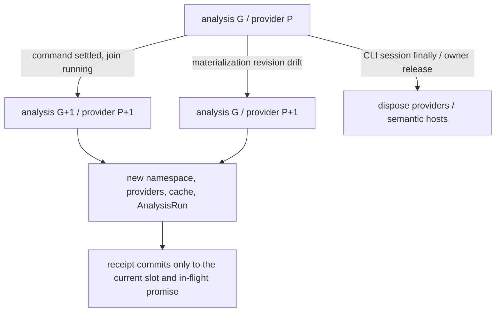

# Limina lifecycle and publication

[English](./lifecycle.md) | [简体中文](./zh/lifecycle.md)

This page owns the full explanation of generations, caches, disposal, artifact mutation, migration, and issue freshness. They protect analysis validity, write authority, publication integrity, and result freshness respectively; they cannot be collapsed into “all state belongs to one generation.”

## Runs, provider generations, and asynchronous publication

The [preflight manager](../../packages/limina/src/preflight/manager.ts) has `#generation` and `#providerGeneration`. A command boundary normally advances both. When base revision drift triggers a materialization replan, only providers, namespace, and caches refresh; the analysis task generation stays unchanged. The snapshot token includes the root and both generations. The numbers themselves are not physical file versions. `ResolvedLiminaConfig.governanceRoot` belongs to config resolution: the nearest manifest is read and validated once, then shared by root classification and root package construction. Provider refresh does not manufacture a second root-manifest fact; a new config resolution establishes a new root snapshot. This bounded snapshot does not freeze child manifests, the entire filesystem, or third-party tool reads.

[executor](../../packages/limina/src/execution/executor.ts) is the current production entry point for creating the generation controller. After command settlement marks an advance, [scheduler-loop](../../packages/limina/src/execution/scheduler-loop.ts) first joins running tasks and then calls startNextGeneration. The manager's [materialization slot](../../packages/limina/src/preflight/materialization.ts) checks the current slot and promise identity to prevent an old asynchronous result from overwriting a new receipt, and allows a new attempt after failure. Commands can change the filesystem, so clearing one query result while retaining old providers is insufficient.

The manager retains ownership of generated artifact application. Its `ensureGraphMaterialized()` delegates to `ensurePreflightGraphMaterialized()` in [materialization](../../packages/limina/src/preflight/materialization.ts), which is the sole production caller of `materializeGeneratedArtifactPlan()`. The [architecture boundary guard](../../packages/limina/src/__tests__/architecture-boundaries.spec.ts) checks both call edges: the helper owns the implementation, while only the manager may invoke it. This extraction does not change generation advancement, replan authority, slot identity, or receipt publication.

A manager with injected custom providers supports only generation zero. Advance/replan checks run before disposal and replacement; failure does not silently substitute default providers. `dispose()` is idempotent, but most manager `ensure*` methods lack a uniform disposed guard. Do not claim that every subsequent API call is rejected. Production callers must stop using it when the run lifecycle ends; whether to enforce this mechanically is an [audit risk](./architecture-audit.md#findings).

Proof declaration validation must forward the active provider's project-config cache through [declaration validation](../../packages/limina/src/proof/declaration-config-findings.ts). Omitting it defaults parsing to generation zero while the generated graph can carry a later Vue semantic identity, causing a valid check after provider replacement to fail. The [proof regression](../../packages/limina/src/__tests__/proof.spec.ts) checks actual Vue coverage in both the initial and next provider generation; incompatible identities still fail admission.

Locate release responsibility along the call chain: [CLI check-run](../../packages/limina/src/cli/check-run.ts) and [standalone](../../packages/limina/src/cli/standalone.ts) dispose their session in `finally`. [Graph export](../../packages/limina/src/graph-check/runner.ts) disposes only preflight it created itself; borrowed preflight/custom providers remain the caller's responsibility. Lower-level [pipeline execution](../../packages/limina/src/pipeline/execution.ts) can create preflight but lacks uniform disposal in finally. Repeated direct calls to that internal API cannot borrow the CLI's lifecycle guarantee. An immutable view of a domain aggregate does not change these actual ownership responsibilities.

## Cache identity and capability scope

| Cache / context                                                            | Key / lifetime owner                                                                                                                                                                       | Invalidation and limits                                                                                                                                                                                                                                                                           |
| -------------------------------------------------------------------------- | ------------------------------------------------------------------------------------------------------------------------------------------------------------------------------------------ | ------------------------------------------------------------------------------------------------------------------------------------------------------------------------------------------------------------------------------------------------------------------------------------------------- |
| Workspace, checker config, lookup, graph, route                            | [AnalysisProviderSet](../../packages/limina/src/core/index.ts) and preflight promises/caches                                                                                               | Provider replacement creates a new set; a path-keyed map is not a process-wide file-watching cache                                                                                                                                                                                                |
| Region trie, canonical projection, exact classification, source config Set | A [WorkspaceRegionPathIndex](../../packages/limina/src/core/workspace/validated/path-index.ts) instance shared through the workspace provider's getPathIndex Promise                       | A provider-only replan also replaces the entire index; do not clear classification while retaining an old trie/projection. The [preflight regression](../../packages/limina/src/__tests__/preflight.spec.ts) rebinds an alias and adds a boundary while leaving the analysis generation unchanged |
| Project dependency collection / preparation                                | [cache](../../packages/limina/src/core/project-dependencies/cache.ts): adapter, family, config/options/raw refs/roots, generation, package/resolver/framework identity, workspace boundary | Final collection additionally includes workspace export policy identity. A callback without identity disables the final cache; returned clones prevent callers from corrupting the cache                                                                                                          |
| Native facts snapshot                                                      | [identity](../../packages/limina/src/core/typescript-semantic/identity.ts): config/options/roots/raw references/admission boundary                                                         | Complete occurrence, resolution, closure and requirement facts are copied before disposal. Persistent reuse also validates file versions and query observations; the context identity alone does not establish freshness.                                                                         |
| Native dependency context                                                  | [Entry](../../packages/limina/src/core/typescript-semantic/index.ts) → Coverage-bounded Program                                                                                            | Release Program after cold collection; validated DTO restoration needs no Program. Pending/locked identities are separate; no oldProgram is retained.                                                                                                                                             |
| Vue                                                                        | [manager](../../packages/limina/src/core/vue-semantic/context-manager.ts) and a process-wide active context slot                                                                           | Owners may share the same identity; switching identities replaces and disposes the old slot. The last owner release reclaims it. Each provider does not exclusively own a long-lived Vue Program                                                                                                  |
| Astro                                                                      | [context](../../packages/limina/src/core/astro-semantic/context.ts) managed by project seed/toolchain, with a lazy Program                                                                 | Snapshots incorporate current source text; manager disposal reclaims the context. External file changes remain bounded by overall provider lifetime                                                                                                                                               |
| Svelte                                                                     | [context](../../packages/limina/src/core/svelte-semantic/context.ts) with one active project; project identity includes adapter/options/config closure/package/files/generation/profile    | Leaf-owned toolchain; per-file sourceText caches are separate from managed lookup identity. This is not a general incremental watcher                                                                                                                                                             |

Native graph collection creates a physically truncated Program per context, not per occurrence; complete inventory comes from the compiler. Pending baselines and locked facts are collected separately, and coloring/promotion cannot rewrite frozen semantics. Dependency collection releases compiler objects after construction. Copied data preserves history without qualifying a new epoch. Explicit TypeEvidence Programs/Symbols are created on demand and measured separately. Count complete DTO restoration, cold collection and final Checker builds independently. [Native incremental regressions](../../packages/limina/src/__tests__/native-context-incremental.spec.ts) and [fresh-process cache regressions](../../packages/limina/src/__tests__/full-analysis-cache.spec.ts) protect removed entries, appearing negative candidates and restoration boundaries.

Runtime project dependency identity includes compiler options/conditions, source files, authority, extensions, package roots, workspace boundary and generation. Native fact cache entries are also keyed by that project identity. Evidence snapshots are cloned and frozen on collection/cache boundaries; no live framework profile is retained. Runtime evidence is copied only when already observed, and cloning never resolves modules. [Project dependency regressions](../../packages/limina/src/__tests__/project-dependencies.spec.ts) exercise context changes, mutation attempts, native resources and generated framework observations.

The [runtime/source collector](../../packages/limina/src/core/project-dependencies/runtime-source.ts) computes the existing semantic identity once per immutable collection request and carries it through the file loop. Purpose, managed-output lookup, options, overlays, membership, package ownership, framework identity and generation retain their existing key semantics. Per-file Astro/Svelte context replacement still clears and recomputes the key; no identity survives a new request through a global memo. Runtime observations still create no Native compilation obligation or reference input. [Dependency regressions](../../packages/limina/src/__tests__/project-dependencies.spec.ts) exercise both compiler and runtime collectors against changed contexts.

Occurrence snapshots retain a SHA-256 digest of workspace boundary identity, memoized by the immutable boundary object in a WeakMap. The original identity contains the full path inventory: deep-copying it for every occurrence/cache clone multiplies workspace size by import count and exhausted the default 4 GiB heap during repository validation. The bounded-snapshot regression uses 10,000 workspace paths; differing membership still changes both the boundary digest and project identity. The weak memo does not retain a disposed boundary.

[FileOwnerLookup](../../packages/limina/src/core/build-graph/file-owner-lookup.ts) owns its lexical/canonical indexes and realpath cache within the current analysis/provider lifetime. New provider generations and replans construct fresh indexes from their respective membership inputs; a missing or retargeted path cannot borrow an old generation's owner. It is not a filesystem watcher and does not extend cache validity across arbitrary in-place filesystem edits.

**Derived**: Runtime-only caches fit controlled run/provider lifetimes. An external caller that reuses the same cache/request generation across file edits may receive old results when source content is absent from the key. This is not evidence that the existing CLI is necessarily stale. Supporting a long-lived daemon requires a mutation/version contract before extending cache lifetime.

## Reads within one analysis

`limina check` is a one-shot command. It does not promise to observe files that an editor, user, or external process changes, removes, creates, or changes back while the command is running. A bounded analysis may reuse its first read; this is neither a frozen filesystem nor an atomic snapshot of the whole command. Existing input/configuration drift checks, publication validation and error propagation still apply when they detect a change. Memo hits do not add another read, stat or hash to recover incidental visibility of external edits.

[Epoch replay](../../packages/limina/src/core/analysis-cache/epoch-inputs.ts) computes one observation from each replayed value and its current physical binding. Receipt comparison and immediate registration use that same observation, with no intervening await or user callback. Registration still rejects conflicts with an existing observation. Separate replay and final stability boundaries read and qualify inputs again. Execution prerequisites may share observations only inside the explicit read-only phase described under [managed execution admission](#managed-checker-execution-admission); effects always require fresh validation. The [lifecycle regressions](../../packages/limina/src/__tests__/analysis-cache-lifecycle.spec.ts) cover synchronous/asynchronous replay, later content changes and conflicting live observations. This removes duplicate computation within one validation step without adding retained state or changing persisted receipt identity.

| Reused input                                          | Owner and first read                                                                                                                                                                                                                                                                                                                                             | End of validity                                                                                                                                                                                                                  |
| ----------------------------------------------------- | ---------------------------------------------------------------------------------------------------------------------------------------------------------------------------------------------------------------------------------------------------------------------------------------------------------------------------------------------------------------- | -------------------------------------------------------------------------------------------------------------------------------------------------------------------------------------------------------------------------------- |
| Successful Vue script text, including an empty string | [VueSemanticContext](../../packages/limina/src/core/vue-semantic/context-handle.ts) holds a path-keyed text map beside its ScriptSnapshots. The first read uses the original overlay system; synchronization still updates/registers scripts and generates virtual code. Missing results are **not cached**, and thrown reads propagate without adding an entry. | Actual context disposal clears the map. The process-wide slot may have several manager owners; releasing one owner does not clear a context still owned by another. Identity replacement or the final owner release disposes it. |

Internal changes remain part of the supported flow. Generated configs are prepared through the existing artifact/overlay path; checker declaration builds retain their independent hosts. Materialization replans and analysis retries replace providers and their project-config cache even when the analysis generation is unchanged. The provider generation participates in Vue identity, so the new input view cannot retain the old active context's memo. An equal identity after the last owner releases also starts with fresh text. Virtual overlays, config/options and toolchain identities retain their existing separation; this text memo adds no process-global map or persistent field. The separate persistent Vue adapter records analysis DTOs and input receipts, not this live text memo. Drift and persistent-input observation keep their validation rules.

[Vue regressions](../../packages/limina/src/__tests__/vue-semantic.spec.ts) cover successful/empty reads, missing/error retries and last-owner release; the [preflight regression](../../packages/limina/src/__tests__/preflight.spec.ts) exercises actual provider-only replan and materialized inputs. A subsequent independent command reads current inputs under the existing persistent-cache invalidation rules; this local text memo makes no cross-command freshness or speed guarantee.

[Astro script synchronization](../../packages/limina/src/core/astro-semantic/context.ts) reuses text from successful context-owned snapshots, including empty text. Volar synchronizes registered scripts on repeated requests; rereading them duplicates filesystem and input-binding work during bounded Program preparation. Initial reads, including reads during context construction, retain the existing analysis-input observation callback. Memo hits perform no additional read or binding check; recorded callbacks still reread at independent stability boundaries. Missing and throwing reads remain retryable. Generation/context replacement and disposal discard the snapshots; there is no process-global or persistent text cache. The [installed-toolchain regressions](../../packages/limina/src/__tests__/astro-semantic-toolchain.spec.ts) cover repeated reads with real Volar, Astro virtual scripts, empty text, missing/error retries, later drift rejection and fresh text after replacement or disposal.

Vue declaration closure projection keeps an occurrence-to-dependency index only within one [support-contribution pass](../../packages/limina/src/core/project-dependencies/support-contributions.ts). It indexes each appended dependency once with the existing occurrence identity and preserves the first match when identities repeat. Support collection still resolves and appends declaration dependencies before lookup; missing facts keep their existing incomplete or unresolved outcome. The index is discarded with the pass and never shared across configurations, providers or invocations. The [project dependency regression](../../packages/limina/src/__tests__/project-dependencies.spec.ts) protects first-match ordering, distinct occurrence positions and separate collections; [graph regressions](../../packages/limina/src/__tests__/generated-graph.spec.ts) cover dependencies appended during Vue declaration traversal.

## Persistent native analysis cache

Declaration origin receipts travel with resolution results and type-environment entries in Native/Vue snapshots. Adapter identities invalidate older interpretations; missing or incompatible required receipts trigger reanalysis. Current root membership and entry reachability determine the governance projection on each collection, including negative membership. Manifest contents, symlink bindings, effective types/typeRoots, declaration content and failed probes remain observed inputs. Removing the last qualifying local entry removes its internal contributions; another qualifying entry preserves shared contributions. This uses the existing project replacement lifecycle and does not widen `replaceProject` transactions.

`check` requests the local analysis snapshot through [AnalysisCacheController](../../packages/limina/src/preflight/analysis-cache.ts). `check [pipeline] --force` bypasses the existing persistent model, performs cold analysis and publishes the new eligible result through the normal publication path. It only prevents cross-invocation semantic restoration: provider refresh may still reuse validated in-memory data from this invocation. The [CLI entry](../../packages/limina/src/cli/register/check.ts) rejects `--issues --force` before configuration evaluation or preflight creation because an issue query performs no analysis.

The public `cache?: boolean | CacheOptions` defaults to enabled. Object form requires `dependencies: string[]`, accepts an empty array, and rejects other fields; the removed top-level `configDependencies` is an error. The [loader](../../packages/limina/src/config/loader.ts) preserves own property descriptors when binding execution metadata, so non-enumerable `cache: false` still disables persistence and enumeration visibility remains available to configuration versioning. The shared [preflight creation boundary](../../packages/limina/src/preflight/setup.ts) applies `cache: false` before constructing a controller, overriding both `analysisCache: true` and `read-only`. Disabled runs neither read nor publish analysis snapshots, even with force, and leave existing snapshot bytes and mtime untouched. They retain execution-local caches, configuration observation/drift protection, issues and independent outputs. Internal `analysisCache: false` and `read-only` controls remain available. `cache: true` does not create a controller for commands that never requested one.

Checker build caches such as `.tsbuildinfo` and check-result queries retain their own contracts. Standalone graph/source entry points can read valid analysis data without acquiring publication authority; their CLI options are unchanged.

[Cache identity](../../packages/limina/src/preflight/analysis-cache-identity.ts) binds the adapter, actual compiler/checker/resolver files, host semantics, config entry and governance root. The actual module-owning package manifest is an observed tool input, including its bytes and binding; embedded migration does not require an installed Limina package merely to identify its cache. [Tool observations](../../packages/limina/src/preflight/analysis-cache-tools.ts) capture file bytes and binding once per invocation, then recheck the captured bindings, package-scope selection and metadata at use/publication boundaries. [Context identity](../../packages/limina/src/core/analysis-cache/identity.ts) binds effective compiler options, raw references, admission and pending/locked checker identity. Runtime generations and complete workspace inventories are not importer versions.

[File digests](../../packages/limina/src/utils/file-digest.ts) read every byte through a bounded buffer for tool and managed-checker identity. Each existing proof boundary still rereads the required files and retains actual length, link, inode and path-binding evidence; no mtime shortcut or cross-invocation digest cache is introduced. [Digest regressions](../../packages/limina/src/__tests__/file-digest.spec.ts) cover chunk boundaries, final-byte edits, hardlinks and symlinks.

[Installation metadata YAML](../../packages/limina/src/core/analysis-cache/installation-files.ts) reuses parsing only within one AnalysisInputs instance, keyed by the content inputId and expectedVersion. Every consumer still observes current bytes through the original read path, retains binding receipts and receives an owned copy. Missing or malformed inputs do not create a reusable successful parse; a new invocation parses again. [Metadata regressions](../../packages/limina/src/__tests__/installation-files.spec.ts) cover parse counts, caller isolation, content changes at the same mtime and drift rejection after consumption.

[Installation environments](../../packages/limina/src/core/analysis-cache/installation-environment.ts) distinguish `observed`, `lockfile-trusted` and `unknown`. An unchanged relevant lock permits trust in the installed types/lib environment it covers. This is an engineering trust contract, not a proof that actual installation bytes stayed identical. Unobserved supplemental installs, manual changes and installation-method switches with unchanged locks are accepted limitations. An actual observed difference still follows invalidation/drift rules. Any related lock's content, existence or binding change revokes this configuration's resolution, native facts and dependent graph records; independently valid syntax, checker `.tsbuildinfo` and other governance scopes remain separate.

[Installation binding](../../packages/limina/src/core/analysis-cache/installation-bindings.ts) starts from actual physical installation domains, manager identity and consuming project scope. It observes selection candidates, manifests and installation settings rather than choosing an arbitrary repository root lock. A pnpm member container inherits a shared installation only when an ancestor workspace and installed pnpm marker agree and the selected lock covers that member; nearer independent lock/installation boundaries prevent inheritance. Bare `node_modules` roots are installed roots too, so their contents do not enter the local directory fingerprint. The bounded adapters support pnpm lock formats 6/9 with shared, independent and custom lock locations; a simple current-branch lock records its actual Git HEAD input. Merged/detached branch bindings and conflicting project-local lock settings use explicit unknown fallback. npm formats 2/3 require a covered project entry; legacy format 1 is root-only. npm shrinkwrap and package-lock candidates are observed together. Yarn's physical host requires classic v1 or the gated modern lock format with workspace coverage and `nodeLinker: node-modules`; PnP/custom hosts do not acquire native cache eligibility. Bun text formats 1/2 require workspace coverage. Binary v0 uses byte identity and an available installed Bun decoder, with root-only coverage. Missing/unreadable locks, unknown versions and unproven coverage cannot grant a clean hit. These gates preserve existing cold analysis capability. Successful pnpm lock coverage checks may be shared for the same selected file, byte version and lock/resolution roots. [Restoration](../../packages/limina/src/core/analysis-cache/installation-lock-coverage.ts) seeds only positive checks from complete, lockfile-trusted contexts after ordinary configuration, input and consumer-coverage validation. Installation adapter v2 records the actual lock root; cross-record validation requires the selected lock byte receipt. Every domain dependency must still be valid. Analysis adapter v17 rejects older records, so the first invocation rebuilds the cache. Each caller still selects the current bindings, reads the full lock bytes and observes their version before using a proof; changed bytes, roots or bindings cannot borrow another proof. Failed or unknown checks are never restored. Repeated dependency validation compares the current observed record directly with its expected version; this does not remove later drift checks. Native-cache Program counters cover eligible contexts only: framework fallbacks must also be counted through bounded and provider Program metrics when assessing the whole command.

[pnpm lock coverage](../../packages/limina/src/core/analysis-cache/installation-locks.ts) accepts supported single-document locks and the [documented environment-then-project layout](https://pnpm.io/lockfile). Only the final project document can prove workspace importer coverage; environment importers are never merged into it. Both documents must parse without errors and use the same supported version. Malformed or missing importer records, environment-only or reversed documents, and ambiguous layouts remain unknown. The complete original lock bytes and filesystem binding remain observed, so even an environment-only change invalidates prior native facts and contexts. [Lock-format tests](../../packages/limina/src/__tests__/installation-locks.spec.ts) cover rejected representations; [native restoration tests](../../packages/limina/src/__tests__/full-analysis-cache.spec.ts) preserve successful member restoration, environment-byte invalidation and independent installation boundaries.

The ordered TS-effective typeRoots list, including inherited paths, is retained. [Local fingerprints](../../packages/limina/src/core/analysis-cache/directory-fingerprint.ts) recursively record paths, entry kinds, regular-file mtimes, missing versus empty roots and link/path identities, excluding node_modules contents. They do not hash every file's contents or substitute parent-directory mtimes. All included entries participate, even unconsumed/backdated files. Shared roots reuse scans only within one observation round; input checks rescan at later use/publication boundaries. Changed roots revoke their shared semantic environment and notify every config subscriber. Outside-root declaration dependencies remain independently versioned. Same-path content changes with retained/restored mtime may escape this metadata fingerprint; touch-only edits can conservatively trigger semantic work. Local scan failures are errors, not empty directories.

[Inputs](../../packages/limina/src/core/analysis-cache/inputs.ts) retain each fact's expected version separately from the current input table. A newer content mtime triggers a read/hash; identical bytes do not manufacture a content change. Untouched checkpoints are not advanced by publication. Existence, directory, path and failed-candidate observations remain independent. Manifest precision is still limited to ordered `imports` and `exports`: field presence, other parsed contents, creation/removal, bindings or incomplete coverage use the domain fallback. There is no typeHash or additional manifest field optimization. Normal NodeNext/Node16 contexts include actual importer scope probes and mode prerequisites, rather than trusting a stored mode constant.

[Configuration loading](../../packages/limina/src/config/loader.ts) evaluates the current entry and its actual loaded module closure in each independent CLI process, capturing owned, deeply frozen pure data for that command. Native loading uses Node's actual root format to select `require` for CommonJS. The [configuration module evidence contract](#configuration-module-evidence) defines startup admission, loader coverage and the boundary excluding general same-process hot updates. An undeclared/unobserved external change after evaluation does not stop or reload the command; the next CLI process consumes newly evaluated values. [Effective config versioning](../../packages/limina/src/config/analysis-version.ts) includes every user configuration property and its enumeration visibility in one `configVersion`, without a field-to-layer impact matrix. Property visibility matters because identical values with different enumerable flags can select different active checkers. A different version logically invalidates the entire analysis model in that config namespace, including resolution, native facts, environments, contributions, ownership/provider projections, graph and indexes. Independently owned checker caches, `.tsbuildinfo` and other config namespaces remain separate. Equal versions still require all ordinary incremental input checks. The new `cache` field participates in this existing version authority; omitted and explicit `true` share execution policy but can conservatively start cold on a representation change. No snapshot schema migration or cleanup is introduced. Continuing functions/closures, proxies and arrays with custom prototypes remain executable or opaque values; an unstable version forces cold analysis without restoring or publishing a cross-invocation model. Function erasure cannot manufacture equality. Observed config/module/governance binding drift stops the invocation without pipeline replay. The [invocation observation](../../packages/limina/src/preflight/config-observation.ts) also protects loaded configurations when persistent cache reads and writes are disabled. Explicit local file inputs use `cache.dependencies`; this adds no general JavaScript I/O tracing.

Configuration validation completes before analysis-cache restoration. Invalid configuration cannot adopt or replace an existing snapshot; returning to valid configuration permits reuse after ordinary input checks. Native context and generated-graph DTOs store TypeScript options and dependency facts. Changing effective TypeScript `customConditions` changes native context identity. The [full-cache regressions](../../packages/limina/src/__tests__/full-analysis-cache.spec.ts) exercise configuration admission and native option invalidation with positive restoration controls.

[Context records](../../packages/limina/src/core/analysis-cache/context-records.ts) and [graph records](../../packages/limina/src/core/analysis-cache/graph-records.ts) validate ordinary DTOs before Program creation. Complete clean native paths restore facts, membership, shared environment, ownership, occurrence contributions and graph projections without analysis Programs, repeated relationship derivation or extra complete enumeration of the trusted installed type environment. Runtime/resource evidence and current judgments retain their own validity and refresh paths. Restored generated content acquires a fresh authenticated [artifact plan](../../packages/limina/src/core/build-graph/analysis-cache.ts); missing or changed artifacts use normal materialization. Program, AST, Symbol, host and write authority are never persisted.

The Vue adapter shares these input, configuration, lock coverage, epoch and publication gates. Schema 10 retains neutral file facts, collection mode, complete Vue context/query receipts, graph context references, and independently validated type-entry/output projection receipts; older snapshots fall back cold without migration or deletion. [Vue input observation](../../packages/limina/src/core/analysis-cache/vue-inputs.ts) wraps the physical compiler host. Volar's synthetic declaration realpath fallback records physical absence and path bindings; it cannot assert that a synthetic file exists. The parsed options object stays immutable when constructing the Volar project host. A clean mixed graph rebinds Vue identities to the current provider generation and creates a fresh artifact plan, without acquiring Vue Programs or deriving the graph again. Eligibility and unsupported-provider limits are defined in [semantic validity](./semantics.md#persistent-importer-validity).

Vue full-graph restoration first rebinds qualified contexts, then checks declaration references through the [producer's shared reference projection](../../packages/limina/src/core/build-graph/cached-vue-references.ts). Validation reuses eligible Vue query facts while preserving declaration closure, resource observations, implicitRefs and provider selection. Current parsed configuration supplies roots; cached roots, edges and admission grant no qualification. Absent Native required relations do not mean absent Vue references. Reference reconstruction is part of restoration validation without repeating complete ownership and graph construction. Removing the last cross-project import rebuilds and removes its reference; mutually consistent cached projections that erase a legitimate reference remain rejected. [Vue cache regressions](../../packages/limina/src/__tests__/vue-analysis-cache.spec.ts) protect these controls.

Vue output contexts have independent identities and observed input/query receipts; their DTO records retain the source configuration path and effective output options. Restoration reparses the source configuration with the current toolchain, reconstructs the output identity and validates its own inputs, options and roots before accepting the output projection. Generated config existence is not identity authority. A source context cannot satisfy an output receipt. [Vue cache regressions](../../packages/limina/src/__tests__/vue-analysis-cache.spec.ts) cover fresh-process restoration without analysis Programs, missing generated configs, output-target invalidation and a receipt rebound to a source context. Unsupported custom plugins and virtual inputs retain the existing cold fallback.

Discovery glob receipts compare a sorted copy of the returned path membership, leaving the reader's result and pattern order unchanged. Asynchronous enumeration order alone cannot cause invocation drift or reject persistent graph restoration. Added or removed members, path bindings and all non-glob values remain exact checks. [Lifecycle regressions](../../packages/limina/src/__tests__/analysis-cache-lifecycle.spec.ts) cover reordered live observations, replayed glob receipts, real membership changes and ordered non-glob reads.

The clean invocation still validates every previous input before [invalidation](../../packages/limina/src/core/analysis-cache/invalidation.ts) decides whether reverse subscriptions are needed. No changed versions means no reverse-index construction; source-version checks still run. Any changed input constructs the complete index from forward records before propagating resolution and shared-environment invalidation. This changes allocation cost, not the authoritative dependencies or invalidation reach.

[Vue query memoization](../../packages/limina/src/core/analysis-cache/vue-memo.ts) belongs to one analysis-cache instance. Each qualified identity object computes its persistent context key once; capture rechecks the full data identity, generation, runtime identity ID and absence of overlays, rejecting drift before publication. New provider identities bind independently. Decoded query results are retained only after validation, with frozen encoded records and fresh copies returned to callers. Domain invalidation still prevents query reuse. [Memo regressions](../../packages/limina/src/__tests__/vue-analysis-memo.spec.ts) cover operation counts, caller isolation, distinct identities, domain invalidation and in-memory identity drift. Custom Vue plugins and Astro/Svelte remain cold fallbacks.

[Snapshot reachability](../../packages/limina/src/core/analysis-cache/snapshot-reachability.ts) streams all forward query and dependency receipts into sets instead of expanding temporary arrays proportional to their repeated references. A per-pass context membership index avoids rebuilding each source list for every importer; it never merges consumer contexts. Unchanged comparison still prunes unused importers, queries and inputs and compares retained record identities; config-input, project-member, manifest and contribution retention remain intact. No digest or dirty flag substitutes for this complete reachability check. Input/configuration stability, epoch, lease and exact physical publication-baseline checks remain independent.

[Receipt tables](../../packages/limina/src/core/analysis-cache/snapshot-receipts.ts) losslessly intern dependency tuples, query identifiers and bounded ordered receipt sequences. Each fact retains its own `(inputId, expectedVersion)` pair; decoding never substitutes the current input version. Sequence sharing preserves order, multiplicity and remainder blocks. Missing table entries, invalid indices and incompatible encodings fall back cold. Parsing shares only privately validated, frozen dependency tuples. Snapshot isolation copies compact records through the tagged data codec before expanding receipts, without serialization, compression or decompression. It retains full values, including undefined and ordered Map/Set entries. Header/configuration evidence is cloned separately; table parsing owns the tuples. No mutable input objects are shared with live analysis. Persisted fields are ordered canonically, while memory copies and opaque compiler options, requests, references and identity data preserve semantic order. Enumerable compiler-options views omit TypeScript's hidden AST attachments without changing public configuration descriptors.

The [store](../../packages/limina/src/preflight/analysis-cache-store.ts) writes `cache/analysis-v2/<config-key>/index.liminainfo` and content-addressed `.liminainfo` blocks under `scopes/<scope-key>/`. The index carries the schema-10 header, required `configVersion`/`configModules`, and block digests/lengths. [Partitioning](../../packages/limina/src/core/analysis-cache/snapshot-shards.ts) groups native contexts, projects, importers, queries and Vue contexts by their actual project configuration path; source and generated declaration configs remain distinct. Complete neutral `files` facts, inputs, graph/contribution records and records without a retained context owner use shared storage. The group inventory derives from the complete record shape, so a new record kind cannot silently disappear from an independent partition list. Each block has its own receipt dictionary. [Payloads](../../packages/limina/src/core/analysis-cache/record-payload.ts) use Node Brotli on complete JSON scope data with declared decompression bounds. JSON retains the existing undefined-field/array-slot behavior. Missing/corrupt blocks, invalid receipts, truncated payloads and inconsistent model coverage cause complete cold fallback, never a partially trusted graph.

[Bounded evidence joins](../../packages/limina/src/core/analysis-cache/bounded-evidence-index.ts) build request, resolution and obligation lookup tables per synchronous qualification call, and fingerprint the expected context once. Coverage derivation for the complete target identity is shared between facts and obligations within that call. Duplicate identifiers, missing members, context provenance, coverage and obligation proof are still checked. These local indexes confer no persistent qualification on mutable DTOs and are not reused across restoration boundaries. [Native restoration tests](../../packages/limina/src/__tests__/native-context-incremental.spec.ts) change member versions and resolved target identities after successful DTO validation, then require rejection at validation and adoption.

[Tagged data validation](../../packages/limina/src/core/analysis-cache/data-codec.ts) walks the same grammar as decoding without constructing a discarded graph copy during complete-model validation. Arity, scalar types, finite numbers, nested entries and duplicate object/map keys retain their checks. The later restore still decodes its own graph. [Codec tests](../../packages/limina/src/__tests__/analysis-data-codec.spec.ts) compare accepted nested values and malformed wire data at both entry points; this does not skip schema or semantic qualification.

Restoration qualifies the small index before any old block read. Identity/schema/configuration-version/module-evidence mismatch and force skip all old scope blocks. Eligible restoration currently loads every referenced block and validates the complete model before ordinary input adoption; this is not lazy per-consumer restoration. Current provider/ownership identities, output receipts, query coverage and all original input/freshness checks remain authoritative. A storage scope is not permission to merge semantic contexts.

Publication retains the authorized namespace, cross-process lease, input/configuration/epoch checks and exact physical index baseline. [Block I/O](../../packages/limina/src/preflight/analysis-cache-blocks.ts) verifies content before reuse, writes blocks first and atomically replaces the index only after the final drift and baseline checks. Interrupted publication leaves the previous index usable; stale writers cannot replace newer indexes. Unchanged blocks keep their bytes and mtime. Strict clean publication still checks inputs without cloning or serializing the model. Provider refresh does not renew the writer baseline. Old `analysis-v1` data is neither imported nor deleted, and publication does not collect unreachable blocks; separate GC would need to protect readers holding older indexes. Active referenced bytes and total retained storage must be reported separately. Storage I/O can omit an update; observation, drift and authority failures continue to propagate, including filesystem-coded failures.

Publication validation runs once for an unchanged model. A changed model checks current inputs after acquiring the write lease and again immediately before atomic index replacement; the controller does not add a duplicate scan before those checks. Read-only, ineligible and missing-baseline branches still validate invocation inputs even when they publish nothing. [Lifecycle regressions](../../packages/limina/src/__tests__/analysis-cache-lifecycle.spec.ts) retain late-drift rejection and storage-error boundaries.

The implementation reuses Node compression/crypto and the existing DTO codec, namespace, atomic writer and lease owners; no new dependency or second semantic authority is introduced. [Storage regressions](../../packages/limina/src/__tests__/analysis-cache-shards.spec.ts), [Native context restoration](../../packages/limina/src/__tests__/native-context-incremental.spec.ts), native/Vue restoration and configuration/process tests protect the distinct boundaries. Storage-size reduction alone does not establish full-command latency or peak-RSS improvement. Public configuration changes retain namespace-wide effective-version invalidation and [analysis implementation identity](../../packages/limina/src/core/analysis-cache/contracts.ts), without cleaning other namespaces or checker caches. Configuration-directory-relative dependencies, module observation, missing/link invalidation and invocation drift rules are unchanged.

Forced reads preserve the exact physical baseline without decoding, validating or restoring the old model. The stored model revision is unavailable for the unchanged-publication shortcut, so an eligible cold result goes through the same lease, input/configuration stability checks, baseline comparison and atomic replacement as ordinary publication. Force does not bypass `configuration-version-unknown` or grant persistence eligibility to executable configuration.

To repair an installation outside the trust boundary, run `limina check --force` (with `--config <path>` for a specific configuration). It refreshes the analysis snapshot from current project state; the next ordinary check can restore the new model. The force switch itself does not delete snapshots, cache directories, issue results or checker `.tsbuildinfo`, and does not request a forced TypeScript checker build. Independent managed build-state invalidation still applies before launch. The store still derives the config key from the resolved absolute config path.

Analysis drift can retry once with fresh providers, TypeScript project-config parsing and membership discovery, while retaining this invocation's frozen Limina config. This transaction contains analysis/candidate planning only; checker execution, commands and artifact writes are never replayed by that retry. Output changes retain the materialization/replan receipt protocol. Late epoch results cannot commit, and disposing an older equal-context instance cannot release its replacement.

[Lifecycle regressions](../../packages/limina/src/__tests__/analysis-cache-lifecycle.spec.ts), [semantic regressions](../../packages/limina/src/__tests__/analysis-cache.spec.ts) and [complete cache regressions](../../packages/limina/src/__tests__/full-analysis-cache.spec.ts) challenge these contracts. `LIMINA_PROFILE=1` records restored contexts/graphs, evidence provenance, probes/scans, reads/hashes, Programs, native queries, projection, cloning and publication separately. Local tests do not establish Windows/Linux behavior or a repository-wide speedup.

### Configuration module evidence

The supported execution model is one CLI command per Node process. Process A evaluates configuration, performs cold analysis and publishes a snapshot; process B evaluates the current configuration and independently qualifies that snapshot before restoring analysis. The [published API](../../packages/limina/src/index.ts) does not expose `loadConfig`; repeated calls to internal loading APIs are not a module hot-update contract. “Every invocation reevaluates configuration” means a fresh CLI process, not clearing every CJS/ESM module and resolution cache in an embedding application. No evaluated configuration object is persisted. Within one command, observed configuration drift still aborts before further use or publication; cold fallback cannot repair stale evaluation or replay commands.

[Load observation](../../packages/limina/src/config/input-observation.ts) records current bytes, actual mtime, logical/physical bindings, governance anchors and original successful requests, targets, conditions and attributes. [Module comparison](../../packages/limina/src/preflight/config-module-comparison.ts) qualifies loader identity, entry presence, members, edges, bindings and per-file content before adopting any old model. Changed modules or edges invalidate the whole configuration namespace even when evaluated values match. Exited helpers are previous comparison evidence, not current drift targets. Source/checker `tsconfig + extends` observations remain independent. Old snapshots never select the current loading closure.

[Per-file construction](../../packages/limina/src/preflight/config-module-snapshot.ts) reuses stored disk-content hashes when actual mtime, binding and file kind match. A different mtime, including a backdate, hashes only that file from captured bytes; equal content permits reuse after a touch. Restoring both the timestamp and binding can hide a content change. Size/ctime alone do not trigger hashing. Strict invocation byte/binding checks remain independent of cross-process mtime trust. Metadata-only changes leave a clean snapshot's bytes, revision and mtime unchanged.

[Actual load source](../../packages/limina/src/config/load-source.ts) distinguishes disk-matching source from observable loader output. Module records carry source provenance; missing source stays unknown, and native source replacement without a supported transforming loader stays incomplete. Observed transformed source receives a separate per-module digest, recomputed on each load. Changed output invalidates restoration even when disk mtime matches. `loaderSourceHashes` and `loaderSourceBytes` expose that cost; no transformed source text or syntax classification is persisted. `evaluationMs` includes loader evaluation and hook callbacks, `hookMs` measures observation inside callbacks excluding the delegated loader, and `observationMs` measures capture/registration/stability work outside evaluation. These intervals overlap and must not be summed as exclusive phases.

Runtime hooks are the first-class dependency observer. They record requests during the configuration loading/evaluation phase, including `createRequire()` with an unloaded synthetic parent. Filtering only by already-loaded parents loses those requests. Copy iterable conditions at the observation boundary: Node 22.18.0 supplies a SafeSet for CJS resolution, unlike the array supplied by Node 24.11.0; leave the context delegated to Node unchanged. Original specifiers are retained rather than reconstructed from resolved filenames, so `require('./foo')` changing from `foo/index.js` to `foo.js` revokes old analysis. Config factories are awaited within the scope. Executed variable imports contribute their actual edges and modules; unexecuted branches contribute none. There is no TypeScript AST scan, parser identity, dynamic-import site list or syntax-driven warning. Continuing callbacks/closures and opaque values still fail effective configuration versioning and cannot acquire persistent model eligibility. Imports after the hook scope ends are outside automatic coverage. Unknown evidence is never promoted by removing a syntax expression: old incomplete snapshots require a cold complete publication before a later warm run.

[Explicit file registration](../../packages/limina/src/config/file-dependencies.ts) captures `cache.dependencies: string[]` from the enabled object form after evaluation into the same `ConfigLoadEvidence`, `ConfigModuleSnapshot` and `ConfigObservation`. Declarations need not be consumed by configuration code. Exact file paths are relative to the selected config file's directory; absolute and parent paths are allowed. Normalized declarations retain logical bindings and resolve to deduplicated physical file records, preserving a pre-existing module role. Missing files, dangling links, creation/deletion, retargeting and declaration-set changes are observable. Directories, globs, URLs and invalid path values are errors. Declared content changes invalidate the namespace even when effective config values match. Missing observations and alias bindings participate in invocation stability alongside bytes, including read-only consumers and commands whose internal access mode disables persistence. Registration cannot retroactively attest that an earlier direct `fs` read consumed the same bytes. External producers must keep inputs stable across evaluation and checking.

This reuses Node's synchronous `registerHooks`, filesystem/crypto APIs and the existing cache owners. Webpack's dependency declarations and per-file snapshots are useful precedents; adapting its compiler-coupled cache, CJS `require.cache` reconstruction or ESM static scanner would add a second authority and cannot preserve original requests. No new package or general filesystem hook is needed. Non-file inputs such as environment variables, network responses, time and randomness are covered only insofar as their effect is represented in the effective configuration data. Hidden behavior requires the existing unknown/cold boundary or `--force`; ordinary undeclared `fs` reads are not speculatively scanned or used to reject every configuration.

[Loader identity](../../packages/limina/src/config/loader-identity.ts) includes backend, runtime options and installed tsx version. Limina creates its tsx scope through public registration APIs and removes only that registration's exact namespace from persisted URLs. User query/hash and other loader modes survive. The registration remains alive for configuration callbacks. Native loading retains a small ESM URL isolation mechanism because CLI initialization can already have loaded a public library subsequently imported by configuration. The tsx backend uses its own registered namespace without adding another isolation token. It supplies fresh load evidence and leaves an already isolated URL unchanged so a factory can import its own URL without a second evaluation. It does not promise fresh Node package/realpath resolution within an embedded process. CJS recursive eviction, process-wide observed-path registries and private `_pathCache` mutation are absent.

Plain native CJS can restore when Node exposes actual load source and all required evidence. [Preloaded CJS admission](../../packages/limina/src/config/preloaded-commonjs.ts) rejects detected cached configuration entries/dependencies instead of treating an unverifiable cached evaluation as current. `createRequire` is observed through synchronous resolution/load hooks; importing `node:module` alone does not disqualify a configuration. Tsx CJS extension hooks can bypass Node load/source observation and therefore remain cold; namespace normalization alone does not prove their completeness. The [CLI configuration boundary](../../packages/limina/src/cli/command-runtime.ts) rejects unrecognized Node startup `--require`, `--import`, `--loader` and corresponding `NODE_OPTIONS` overrides before evaluating configuration. A preload can populate Node's package resolver cache and then change manifests; unknown/cold alone would still execute the wrong configuration. Recognized repository tsx startup is supported only when its resolved path belongs to the installed tsx package; the bare name alone is not trusted. use `--config-loader tsx` for product transformation. Arbitrary embedding and third-party preload combinations are not supported. Programmatic source replacement observed by the hooks cannot silently reuse a disk-only digest. Opaque schemes, unobserved formats and overlapping loads remain incomplete. Automatic completeness is limited to reliably observed module-loading facts, not all JavaScript side effects. Configurations that replace the module machinery or launch unjoined loading work are outside this supported observation boundary; `cache.dependencies` supplements it only for local file inputs.

The acceptance owners are [module/gate tests](../../packages/limina/src/__tests__/config-module-cache.spec.ts), [lifecycle tests](../../packages/limina/src/__tests__/analysis-cache-lifecycle.spec.ts) and [real CLI process tests](../../packages/limina/integration/tests/config-process-cache.spec.ts). Positive warm controls must precede schema/version/module/incomplete/content/binding/edge corruption, and assertions must observe old-model adoption or graph restoration and Program counts, not only final output. Cross-process cases retain the same disk snapshot while starting new Node processes. Loader trust cases distinguish stale evaluation, unsafe restoration and deliberate cold fallback. Force, issue-only queries, disabled/read-only caches, analysis failures, strict drift, clean publication and real competing writers retain their existing contracts. Compare whole-command and load time, disk/output hashes, Programs, snapshot read/parse/validation/write costs and size; successful tests or zero disk hashes do not establish an overall speedup or untested platform compatibility.

## Provider-owned raw syntax reuse

The Native production entry no longer owns a separate SourceSyntaxFactsCache or Programless scanner. The compiler parses SourceFiles actually admitted by the frontier. The runtime collector observes the caller's current AST rather than borrowing another potentially mutated framework AST with equal text/path. [Import analysis regressions](../../packages/limina/src/__tests__/import-analysis.spec.ts) retain the independent mutated-AST, shadowing, require.resolve and createRequire contracts.

Neutral file-fact structures remain owned by the existing storage codec but are not Native discovery authority. First publication and cold analysis must record actual bounded-program-create work; absence of TypeChecker calls cannot be reported as zero Programs. This version neither reuses oldProgram nor promises changed-file-only parsing. Future in-memory reuse needs proof of channel inventory, contribution revocation, context and physical identity; merging current hook logs is insufficient.

Measure performance by environment × workload × cache state: Native, mixed framework and repository; cold analysis, first normal publication, fresh-process restoration, incremental analysis and clean Checker build. Timed samples are uninstrumented; diagnostic metrics run separately. Retain individual wall/CPU, parent/child memory, Program/TypeChecker and read/parse/restore/publish costs, declaring OS/tsx cache state. Frozen budgets cannot be relaxed after measurement. Smaller storage or zero TypeCheckers does not establish end-to-end improvement.

## Source phase observations

[Source phases](../../packages/limina/src/source-check/phases.ts) separate read-only preparation, Knip execution/cleanup, and read-only ownership/authority/reporting. The runner executes them sequentially under the **existing whole-task resource declaration**. The public task remains `source:check`, and the final source result is published once. Knip failures or cleanup errors still prevent later phases from publishing success. Phase wall observations do not authorize concurrent readers while temporary Knip entries are visible, nor weaken manifest, repository, generated-file or cross-process lease constraints.

[Vue dependency collection](../../packages/limina/src/core/project-dependencies/provider.ts) and [qualified Vue receipt binding](../../packages/limina/src/core/analysis-cache/vue-execution-inputs.ts) each create a fresh `PathBindingReplay` for one synchronous read-only batch. Only ancestor link observations are shared; leaf metadata, realpaths, content reads and receipt comparisons remain live. The scope ends before any await, materialization, managed write or process launch. Admission and publication retain independent fresh validation. [Admission regressions](../../packages/limina/src/__tests__/execution-admission.spec.ts) reject later content changes and an ancestor retarget to the same canonical declaration with caching enabled or disabled. This reuse is not an atomic filesystem snapshot.

## Namespaces, physical identity, and plans

[namespace-core](../../packages/limina/src/domain/artifacts/namespace-core.ts) records the logical root, canonical root, and generation token, and authenticates through an internal WeakSet. An [artifact plan](../../packages/limina/src/domain/artifacts/plan.ts) is also authenticated and bound to the same token. Two freshly created namespaces with the same root and numeric generation cannot exchange plans. Production graph generation creates revisioned plans; an internal constructor for unrevisioned plans exists, so base-revision checking cannot be generalized to every API input.

Generated config identity is evaluated relative to the active workspace root. A `.limina` name in an ancestor directory must not misclassify a nested workspace's source config. [Mutation authority](../../packages/limina/src/utils/mutation/authority-create.ts) obtains canonical identity for a trusted base and checks the logical chain, scope, and containment. Locating an output does not automatically grant permission to mutate it.

[Identity checks](../../packages/limina/src/utils/mutation/identity.ts) combine lstat/open/fstat, content/hash, device/inode, links/metadata, and other checks to validate bindings. Logical symlink/junction, physical escape, and binding drift have separate rejection paths. These are concrete execution guards, not proof of absolute race freedom against every operating-system concurrency attack.

## Publishing and recovering generated artifacts

Generated declaration directories and incremental cache paths retain the complete source config basename, including `tsconfig.` and `.json`, within their existing checker and directory partitions. This distinguishes `tsconfig.json` from `tsconfig.tsconfig.json`. Planning rejects paths claimed by different source configs. Regeneration updates owned configs; stale cleanup uses the prior ownership ledger and does not recursively delete unowned compiler caches or user files. [Namespace guards](../../packages/limina/src/__tests__/artifact-namespace.spec.ts) and [graph regeneration tests](../../packages/limina/src/__tests__/generated-graph.spec.ts) cover path conflicts, old ownership ledgers and repeated preparation.

The production path through the [materializer](../../packages/limina/src/core/build-graph/materializer.ts):

1. Authenticate the namespace/plan and acquire the cross-process writer lease for the canonical root.
2. Read the base revision under the lease. On drift, perform at most one complete replan, requiring the same canonical lease root.
3. Write an in-progress marker containing the base/desired revision and owned-path universe.
4. Write desired files and delete old owned paths absent from the desired set; write the manifest last.
5. Verify the desired tree and remove the marker before completing the receipt.

After failure, the marker remains and a reader lease reports recovery required. The next writer recovers with a complete new plan, verifies it, and removes the marker. Manifest-last is part of the protocol, not a filesystem transaction that atomically writes multiple files. Recovery has no general journal or backup tree. Checker typecheck selects targets (including the empty-target decision) from the materialization receipt, after any replan. Its [read lease](../../packages/limina/src/core/build-graph/materialization-read-lease.ts) checks that the current artifact revision still matches that receipt before running a checker; drift fails explicitly and requires rerunning the command. Checker builds, selected checker builds, and managed output builds use the same receipt/revision handshake before compiler execution. A reader lease alone cannot authorize an in-memory classification against a newer generated closure; unrelated artifact consumers retain their separate contracts. [Regression coverage](../../packages/limina/src/__tests__/typecheck.spec.ts) changes leaves and package roots between planning and materialization, and replaces a receipt before acquiring its read lease.

[Manifest version](../../packages/limina/src/core/build-graph/manifest-version.ts) / [ownership](../../packages/limina/src/core/build-graph/manifest-ownership.ts) allow older formats only as cleanup ownership ledgers; production types define the current schema. At the time of inspection it was v5; v1–4 are not reused as current graphs. Future/invalid versions are rejected. Ordering uses code-unit comparison. Runtime capability descriptions and live source descriptors do not thereby become persisted graphs.

Namespace materialization governs managed generated artifacts. User-selected graph export files, external tool output from `build --raw`, and migration have different writer contracts. Do not claim that every disk write passes through the materializer. Managed checker output separately validates authority through [managed-mutation](../../packages/limina/src/typecheck/managed-mutation.ts) and [output](../../packages/limina/src/typecheck/output).

Cross-process holders publish immutable token-named owner records by directory rename. Reclamation removes only the observed record and then uses nonrecursive rmdir; a replacement holder has a different record and prevents removal of its nonempty directory. Release follows the same rule. Empty published slots left by interrupted cleanup are recoverable; unpublished reader candidates are excluded from reader membership and are never reclaimed as empty leases. Legacy `owner.json` records can be retired but are never newly published. This is a cooperative protocol among current Limina processes; concurrent older binaries that recursively remove holders are outside it. [Lease reclamation guards](../../packages/limina/src/__tests__/cross-process-lease-reclamation.spec.ts) delay both record deletion and directory removal while another writer acquires the slot.

A holder publication rename returning `EEXIST` or `ENOTEMPTY` already establishes contention; retry even if that holder releases before the follow-up inspection. Requiring it to remain present turns a valid release into a fatal persistence error, including during check-index publication. Ambiguous Windows-style `EACCES`, `EBUSY`, and `EPERM` still require a present holder; unrelated I/O errors must propagate. Retry returns to the existing bounded acquisition protocol and does not bypass owner validation, stale-owner reclamation, or latest-attempt checks. [Publication guards](../../packages/limina/src/__tests__/cross-process-lease-holder.spec.ts) cover a real POSIX collision followed by release, both definite error codes with an absent holder, and permission/error controls. The [concurrent CLI regression](../../packages/limina/src/__tests__/cli.spec.ts) rejects persistence warnings and includes query stdout/stderr on failure. This preserves I11 publication integrity and I12 freshness; a bare CI query exit code alone does not identify which persistence failure occurred.

Exclusive declaration publication captures the new empty file identity before writing, syncing or reading it back. Failure retains that identity for rollback; incomplete content must still be a prefix of the intended bytes, with matching device/inode/mode/link count. Verified files retain full content-hash checks. Parent directories enter the transaction ledger one at a time, before creating the next directory, so a later failure cannot discard earlier cleanup ownership. Unreadable identity or external replacement never grants deletion authority. [Publication failure guards](../../packages/limina/src/__tests__/output-publication-failures.spec.ts) inject partial writes, sync/readback failures, directory failure and replacement, and check retry plus user-file preservation.

## Managed Checker execution admission

Materialization and execution have independent admissions. A diagnostic candidate may be materialized while applicable `deny.refs` prevents a managed Checker target from running. [Execution admission](../../packages/limina/src/typecheck/admission/execution-admission.ts) is shared by managed builds and the separate framework typecheck pool. It checks mutation, launch and output-copy boundaries under the materialized revision lease and current input proofs. It does not call the complete `graph:check` pipeline, change Core completion, erase relationships or guarantee Checker success.

A Native external-library implementation input can supply a consumer's type without establishing a consumer emit obligation or a generated Project Reference. The compiler solution builder can then skip an unchanged consumer after the source package changes. [Managed build-state proof](../../packages/limina/src/typecheck/managed/build-info.ts) conservatively marks consumers carrying that locked Native absence proof for a full check. The existing authorized mutation boundary removes only their authenticated build-info files before launch, for both internal declarations and user-output builds. The policy participates in the mutation fingerprint; unrelated leaves retain incremental state and the existing missing-output recovery rule. No compiler-private build-info format is parsed, no producer or reference is invented, and no extra process target is selected. This deliberately rebuilds affected consumers even when their inputs are unchanged; selective reuse needs an independent consumed-input proof. [Fresh-process regressions](../../packages/limina/integration/tests/source-package-incremental.spec.ts) cover public-type changes, same-mtime transitive changes, analysis force, unaffected leaf reuse and managed output builds.

The [reference closure](../../packages/limina/src/typecheck/admission/reference-closure.ts) starts at the selected command's actual configuration. Generated declaration/output aliases retain their source configuration and Checker identity. Actual references, including transitive `implicitRefs`, determine reachability; dependency scheduling edges are not a substitute. Solution and wrapper relationships provide reachability without satisfying a declaration obligation or introducing container-label policy. Framework source commands use their source configuration and capability context; schedules neither become Project References nor select additional processes. [Pure reference governance](../../packages/limina/src/graph-check/reference-governance.ts) reuses existing rule normalization, label matching, aliases and findings, and evaluates applicable `deny.refs` only in that execution scope. Rule normalization knows every valid Checker mapping, while matching stays specific to the current edge; an unrelated legal cross-Checker rule target is not an unavailable mapping.

A refusal is local to the actual process target. One command covering several projects is refused as a whole; independent targets continue. Scheduling order alone does not propagate process failure. The [scheduler](../../packages/limina/src/typecheck/build/dependency-plan.ts) accepts explicit execution prerequisites separately and propagates only their failed target identities, including through blocked targets. The selected commands alone form the process set. A managed entry consumes its own Project Reference closure and carries the output-copy responsibilities of the projects it covers. [Prerequisite proof](../../packages/limina/src/typecheck/admission/execution-prerequisites.ts) can order already-selected producers only when a current missing input uniquely maps to their authenticated output or copy plan and the consumer cannot supply it itself. Delivery completion includes required copying; a schedule or ordinary reference is insufficient. Existing consumable declarations do not acquire a source-freshness requirement merely because a provider is selected. This is not a planner for missing external generators. [Target outcomes](../../packages/limina/src/typecheck/target-types.ts) distinguish `admission-rejected`, `blocked` and actual process results. Admission failures have no synthetic exit code; command failure uses `execution-admission` unless a real process failure also occurred. Output-copy rejection retains the successful Checker result. Checker-owned admission issue codes retain governance details without claiming a `graph:check` execution. Deferred reports retain admission decision, stage, target identity and input diagnostics even when process output is hidden.

[Execution input scopes](../../packages/limina/src/core/analysis-cache/execution-inputs.ts) select existing `EpochInputs` observations and locked context receipts; they do not acquire a new baseline to excuse drift. Pending aggregate evidence is retained but is not a locked qualification. Cold analysis, validated restoration and `cache: false` retain runtime observations. [ConfigObservation](../../packages/limina/src/preflight/config-observation.ts) freezes invocation governance data, observed configuration modules and root bindings. Necessary configs, labels, references, extends, source content, resolution probes, Coverage and Checker implementation identity remain subject to live checks. Global cache publication still validates its complete observation set; that union is not the per-target execution scope. Cached facts must requalify, and no execution permit or reusable execution-admitted result is persisted. The generated-graph v4 binding checks actual generated JSON references against current source/implicit references, Native evidence and Checker mappings before accepting or materializing a cached candidate. Mutually consistent cached projections do not authenticate each other. A failed binding falls back to analysis without a complete graph hit. [Framework observations](../../packages/limina/src/core/analysis-cache/framework-execution-inputs.ts) retain source-specific transitive source/declaration consumption and resolution probes independently of schedule edges. Svelte configuration discovery and observed executable module imports join the consuming scope. Live configuration proof retains original content and resolution bindings across managed refresh, including CommonJS loads without serializable format/source receipts; that missing persistent-cache metadata does not by itself invalidate live proof. Unknown loading evidence still prevents execution. Astro targets use `--noSync`; unrelated Astro sync configuration is not frozen. Framework context provenance that cannot be restored is recollected. Vue compiler reads retain a source-context scope even with caching disabled. Restored Vue dependency receipts rebind to live content, physical identity and resolution replay; memoized cache validity does not authorize execution, and unrelated context observations are not merged into that scope. Each equivalent runtime identity receives that binding, including analysis rebuilt after graph DTO rejection while qualified Vue contexts are reused.

[Input coordination](../../packages/limina/src/typecheck/admission/input-coordinator.ts) compares proven managed write footprints with active target observations. Ordinary emit, build-info updates and copy destinations are not frozen semantic inputs merely because they are files. A mapped declaration that also supplies evidence retains its input role. Completed writes capture separate output receipts; only receipts intersecting the pending target’s content, existence or directory-membership observations participate in its handoff. Copy sources remain protected inputs. The invocation retains one coordinator across graph refreshes, revokes old permits, and permits one refresh per write batch after related work and old leases finish. New reservations wait for the refresh barrier; an already-published preflight graph cannot create a second coordinator. Unchanged ordinary source and governance inputs must still match their original baseline. Refresh prepares a private provider lifecycle, recollects/revalidates facts and materializes the new plan before publishing graph, snapshot token, providers and artifact revision together; it cannot add an unselected command or rerun a completed Checker. Unproven handoff or input drift refuses affected remaining work. Copy uses the existing authenticated copy plan. Independent scopes may run concurrently. Watch authorization covers startup; its reservation is released when the process launches and does not promise continuous authorization of internal watch rebuilds or an atomic filesystem snapshot.

[Input replay rounds](../../packages/limina/src/core/analysis-cache/epoch-inputs.ts) share current observations for equal keys, paths and descriptors within one explicit read-only prerequisite phase. [Validation ownership](../../packages/limina/src/typecheck/admission/input-validation.ts) bounds this reuse to the active async phase and coordinator revision. Baseline, current and context scopes still compare their own expected versions and path bindings; managed-output exceptions do not transfer to strict scopes. Completed managed writes, graph refresh and every effect-boundary permit check invalidate the shared phase. Cleanup, copy and launch checks always read fresh inputs, including changes inside the authorization callback. Expired async phases cannot retain reuse authority. A replay round shares ancestor symlink observations for sibling paths, while leaf metadata and physical realpaths remain freshly observed; later rounds rebuild the ancestor bindings. The implementation reuses Node AsyncLocalStorage, filesystem APIs and local Maps without adding a dependency or mtime trust. [Replay regressions](../../packages/limina/src/__tests__/execution-input-replay.spec.ts) and [admission regressions](../../packages/limina/src/__tests__/execution-admission.spec.ts) cover repeated-reader cost, same-mtime content changes, equal-content symlink retargeting and managed-exception isolation; this is not an atomic filesystem snapshot guarantee.

[Prerequisite output proofs](../../packages/limina/src/typecheck/admission/execution-prerequisites.ts) hand their initial mutation coordinator to the selected build only while the graph object remains current. A managed-output graph refresh requires a new coordinator. Reservation and mutation use that initial baseline; layer and target barriers still re-prove the full fingerprint, projected outputs and live mutation boundary. The effect-boundary permit still replays inputs before build-info cleanup and process launch. [Managed mutation tests](../../packages/limina/src/__tests__/managed-mutation.spec.ts) retain effective-config and output-symlink drift rejection. One input validation hands its checked reference closure directly to governance and the immediately following permit binding; later permit checks collect and validate a fresh closure. Each closure builds its alias table once. Existing owner handoffs, Maps and the codec satisfy this scope; a generic memoizer cannot establish graph lifetime or side-effect authority and is not needed.

[Execution permits](../../packages/limina/src/typecheck/admission/execution-permit.ts) are opaque runtime capabilities registered in a private WeakMap and revoked when the authorization callback finishes. Cleanup, runner launch and copy consume them at the effect boundary. Binding includes target selection and arguments, Checker implementation, typed reference closure, input scope, snapshot/provider lifetime and artifact namespace/revision. Copy additionally binds its concrete plan and existing copy authority. Field copies, JSON restoration and cross-stage or cross-target reuse confer no permission; a permit never replaces the artifact lease or live input replay.

[Admission regressions](../../packages/limina/src/__tests__/execution-admission.spec.ts) cover inferred and transitive implicit denial, independent targets, unchanged Core evidence and input drift. [Handoff regressions](../../packages/limina/src/__tests__/execution-input-handoff.spec.ts) exercise an already-running producer, fresh declaration evidence, independent work and rejection of concurrent ordinary-source changes. [Checker host tests](../../packages/limina/src/__tests__/checker-host.spec.ts) distinguish scheduling from explicit failure prerequisites. These guards do not establish arbitrary third-party generator contracts or cross-platform race freedom.

## Migration is a separate transaction

`limina-migrate` owns planning, transactions and fresh-process verification. Its build resolves workspace `limina/internal/*` modules through the core package export map directly to current `.ts` core source and embeds the existing readers, providers, errors, namespace and physical guards together. The build rejects core modules from distribution paths and duplicate real-file instances; it does not require an aggregate migration support module. Source ownership stays in core; the verifier and renderer are built into migrate and resolved from that installation. One execution retains one producer/consumer copy of authenticated tokens, error constructors, writer queues and semantic contexts. I01 workspace authority, I09 generation identity and I10 physical write boundaries retain their existing semantics. Distribution details belong to [repository architecture](./architecture.md#limina-boundary).

CLI and verifier check the two embedded source versions against the installed migrate self manifest. A tool artifact mismatch fails before writes, or makes fresh consumption unavailable. After normal config loading and before writes, the CLI observes package version metadata from the config and validated governance-root anchors, with explicit same/different/not-installed/unavailable states. This observation never loads the project’s internal support and does not change audit schema, consumability diagnostics or exit semantics. Configs importing public `limina` still require it to be installed where the config resolves packages; missing imports fail before writes, without rewrites, shims or installation. Neutral configs can use migrate alone when required TypeScript and enabled optional capabilities are satisfied. Persisted schema paths remain owned by public Limina; a missing project schema receives a non-blocking editor-scope warning.

[Migration scope](../../packages/migrate/src/migration/scope.ts) selects an explicit config, then an ancestor default config, then the nearest manifest only when no config exists. Flow confirms the original cwd, root binding and source before user module evaluation; only this prompt defaults to Yes, and `--yes` replaces only it. File identity/content and root binding are rechecked after confirmation. Defaults use the core [input factory](../../packages/limina/src/config/default-inputs.ts) with no configPath or fabricated module-load evidence. The internal input type is shared by the readers; the ordinary loaded-config type and check CLI retain a required real config. Migration creates a namespace capability directly for read-only analysis and report ownership, without starting another preflight lifecycle or persistent cache.

[Write-plan preview](../../packages/migrate/src/migration/write-plan.ts) derives its complete stable file list from effective frozen patches, not discovery paths, checker entries or repeated analysis records. Normal write checks may only shrink that set. `--dry-run` exits at this boundary, before Git/identity write checks, specialized prompts, transactions, graph/cache output, all audit publication and post-write verification. Complete previews require governed sources; structural incompleteness fails, while unavailable dependency comparison preserves native intent conservatively. User config and existing third-party entrypoints remain executable rather than sandboxed. Each invocation replans.

Default context stays in memory unless exact isolation exclusions need persistence. Then a minimal static `limina.config.mjs` create operation joins the existing group with its dependent rewrites. [Create execution](../../packages/migrate/src/migration/transaction/create.ts) validates the physical parent and uses create-only publication of prepared bytes; a later entry is never overwritten. Creation and empty existing files are distinct. Group failure rolls back an owned unchanged creation; drift or uncertain update recovery preserves the target and reports incomplete recovery. No whole-workspace transaction or writer lease is added. [Workflow tests](../../packages/migrate/src/__tests__/migration-workflow.spec.ts) and [transaction tests](../../packages/migrate/src/__tests__/migration-transaction.spec.ts) own the new counterexamples.

The [migration planner](../../packages/migrate/src/migration/planner.ts) freezes one config overlay, topology edits, dependency comparison, JSONC patches and physical snapshots before writing. Candidate descriptors, default checker entries and managed source closures remain different sets. [InputTopologyResult](../../packages/limina/src/core/build-graph/input-topology.ts) reuses normal workspace, entry and source/solution readers. One input read shares its region path index across entry and solution collection; each subsequent candidate and fresh-process read creates its own index. DependencyAnalysisResult separates completed semantic facts from projection/governance diagnostics; incomplete analysis is never an empty proven graph. Missing effective Program members carry a config/file/stage input diagnostic rather than escaping as a generic error. Migration also records unexpected semantic preparation failures as unavailable comparison, preserving readable source identity and native declarations. Missing-import observations retain config, file, specifier and inference stage even when no governance finding applies. Generation-local config overlays reach parser, ownership evidence, semantic hosts and cache identities. They do not add manifest fields or persistent partial-graph authority.

Unreadable files are preserved. Empty or malformed JSONC is isolated as an input failure; duplicate governed keys remain ambiguous editing inputs and require manual resolution. Exact `scope.regions.exclude` of kind `tsconfig` is applied before output reading without deactivating the package; all affected memberships and implicit references must be pruned. Static config syntax editing preserves modules rather than serializing evaluated exports. Unsupported dynamic exports, ambiguous JSONC, existing visibility cycles without a safe baseline, or solution declarations that cannot be isolated without losing healthy membership leave an explicit incomplete result. All readable source candidates in activated regions are normalized, including independent named configs; normalization does not select new checker entries. Native source declarations to solutions expand to their retained source members before comparison, using the membership reader and recording the original target and expanded members. Checker mapping, declaration providers, cycles and policy remain normal core analysis concerns. Undiscovered reference targets are classified against the already discovered activated config topology, without target contents or physical-path probes; this logging classification grants no relationship authority. Named pure wrappers expand with rebased paths; path-only wrapper back edges are cut during expansion, and default solution cycles use compensating membership. Reachability is checked against the pre-expansion retained source set. Bad named targets are pruned from every parent solution, including unselected named wrappers. No `extends` removal or native build equivalence is promised.

Compiler options remain intact. Existing valid output contracts win over native values; effective noEmit, declaration-only, outFile and split directories constrain optional output adoption. [Output trials](../../packages/migrate/src/migration/output-adoption.ts) add proposals in stable path order and run the whole candidate input chain. A closed core reader reuses one package/descriptor discovery snapshot only within this read-only output phase; overlays may change, while root, regions and package selection remain fixed. Output declarations, stable visibility and physical output authority are revalidated per candidate. Final planning and fresh disk verification use ordinary discovery; no global cache or post-write snapshot reuse is introduced. Directory safety alone is insufficient: descriptor stability, retained entries and each entry/solution's source reachability must survive. A proposal that hides itself or another healthy source is rejected without isolating that source. A failed baseline is not an empty protected set; no combination search or post-write replanning occurs. [Migration topology tests](../../packages/migrate/src/__tests__/migration-topology.spec.ts) and [published CLI coverage](../../packages/migrate/integration/tests/migration.spec.ts) own these contracts.

[Commit groups](../../packages/migrate/src/migration/commit-groups.ts) couple edits of a solution cycle or a shared required isolation; independent files do not join a workspace-wide rollback. Edits targeting the same config path are coalesced before execution; different paths aliasing one physical file are rejected. Git roots and dirty-worktree confirmation retain their existing authority boundary. [Transaction execution](../../packages/migrate/src/migration/transaction/execution.ts) preserves identity/content/metadata checks, atomic single-link replacement, and explicitly non-atomic in-place hardlink writes. Recoverable group failures restore that group and allow independent progress. Uncertain mutation or rollback stops with recovery evidence. Input drift after prompts invalidates the frozen plan; no cross-process writer lease is claimed.

[Fresh-process verification](../../packages/migrate/src/migration/verification.ts) starts separate workers for check and graph, each rebuilding the explicit input source. Existing and newly created real configurations are loaded once; defaults reread the locked manifest/workspace and use the same core default-input factory. Original input source and final verification source are reported separately, and a missing generated config cannot be replaced by memory exclusions. This preserves CommonJS support without relying on module hot updates. It reads actual disk inputs with the normal check/graph input readers embedded from the same-release Limina source, without overlays or reports. Success proves this embedded input implementation consumed the disk topology, not that arbitrary installed project Limina, full typechecking or graph governance ran. Required write failure, missing protected membership, structural failure, no governed source or unavailable verification prevents successful adoption. Optional output rejection alone does not. The independently published `.limina/migration/latest.json` records processing, comparison, conversion, writes and verification, including phase timings and fatal attempts when the audit location remains writable. Terminal results show isolated configs, removed outside references, comparison completeness, analysis diagnostics and failed/skipped groups alongside the report path. Governance diagnostics and missing source generation do not by themselves fail input consumption; residual structural or required-write failures do; publication failure warns without rolling back configs. Reports grant no graph or later-migration authority. See the [CLI contract](../../docs/en/cli.md#limina-migration) for editable module shapes and exit semantics.

POSIX checker execution tracks the owned process group through termination, including after its leader exits. Natural leader completion starts descendant cleanup even without cancellation; successful cleanup retains the leader’s original exit status. Escalation is not cancelled by the leader’s close event. The runner waits for pending group cleanup before reporting completion, and the checker host retains the group until cleanup settles, including during host shutdown. Cleanup has a bounded timeout reported as a failed measurement. [Process-group tests](../../packages/limina/src/__tests__/process-tree.spec.ts) use responsive/stubborn descendants, an already-exited leader and direct/host execution. These tests do not establish Windows taskkill descendant behavior.

## Issue identity and freshness

Command help is a completed CLI outcome. CAC clears its matched command after printing help, so the CLI records the matched state during help rendering before applying the unknown-command guard. Global and nested help do not load configuration or create governance artifacts; unknown commands still fail, including when help was requested. The [CLI tests](../../packages/limina/src/__tests__/cli.spec.ts) exercise real processes and these side-effect controls.

Inline terminal write tracking keeps the original Writable receiver when forwarding chunks and restores the exact original method afterward. A stream shared by stdout and stderr is patched only once. Buffer/string encodings, callbacks and backpressure remain the stream’s responsibility. [Real Writable tests](../../packages/limina/src/__tests__/terminal-frame.spec.ts) cover both write overloads and the complete inline reporter. The normal subprocess renderer and status-only reporter are separate paths; this protects the inline fallback when no subprocess renderer is available.

Finding producers retain typed semantic facts; issue projectors compose stable identities, deduplicate, and sort by domain. Different semantic findings at one location must not be swallowed because their display fields match. [check-reporting](../../packages/limina/src/check-reporting) defines the canonical issue inventory; terminal presentation does not determine fact identity.

[check-attempt-io](../../packages/limina/src/source-check/snapshot/check-attempt-io.ts) publishes sequence, attempt identity, and started metadata. On completion it commits `last-run.json` and the latest-completed metadata/digest that authenticates it. An older completion cannot supersede a newer sequence. Current [snapshot types](../../packages/limina/src/source-check/snapshot/types.ts) are check v9 and source v2. The standalone [invocation snapshot](../../packages/limina/src/check-reporting/invocation-snapshot.ts) is a separate v1 schema with an independent invocation ID. Do not conflate these three versions. Reader and writer rejection messages derive the supported check version from `CHECK_ISSUE_SNAPSHOT_VERSION`; old/future check wire models are still rejected. [Snapshot tests](../../packages/limina/src/__tests__/source-snapshot.spec.ts) and [completed-attempt tests](../../packages/limina/src/__tests__/check-attempt.spec.ts) cover invalid writes, version rejection, and coherent metadata whose snapshot uses an old version.

`check --issues` queries persisted state without running a new check. Its `QueryConfigAnchor` is distinct from an `ExecutionConfigLocation`: explicit paths are resolved lexically against cwd and need not exist. The locator searches from their dirname for the nearest manifest and validates that object without classifying membership, importing config, evaluating config functions or constructing preflight. Without an explicit path, it discovers a currently existing default config. It never redirects missing records to an ancestor workspace. Emitted invocation commands bind the absolute config, Node executable and installed Limina binary; [replay coverage](../../packages/limina/src/__tests__/single-package-cli.spec.ts) removes the config and verifies identical persisted state and no additional config execution. Latest running/interrupted/aborted/persistence-failed/corrupt metadata, or an inconsistent completion pair, forbids fallback to an old inventory. A corrupt latest attempt also blocks allocation of a new sequence. Explicit standalone invocation queries have their own input validation and are not the latest full check.

Completion, failure, not-run, and unavailable inventory must be reported separately. Machine JSON/NDJSON and human text may present them differently, but unavailability must not be reported as zero issues in the current run. Performance observations from `LIMINA_PROFILE=1` do not change issue authority. Atomic profile/snapshot writers do not imply cross-file atomicity for the entire check.

## Release registry snapshot lifetime

[Release command execution](../../packages/limina/src/commands/release/command.ts) loads registry configuration inside the guarded command flow, before entry scheduling. Environment values and relevant npmrc entries are copied once, then each dependency selects its authority from that captured configuration. The authority travels through metadata, baseline and tarball calls; request helpers do not reread process environment. Metadata reuse remains local to a release consistency state and is keyed by the full normalized registry base URL plus package name. It never caches an importer's baseline/ignore decision. Later file/environment edits affect a later invocation. See [release network authority](./system-model.md#release-registry-authority) for URL and response limits; this snapshot does not change provider-generation or issue-attempt lifetime.

## Unified dependency observation coverage

Resolution, preparation, explicit TypeEvidence, dependency observation and support-input enumeration have distinct query coverage. Restoring one does not satisfy another. Native capture records completeness without forcing unrequested evidence queries at disposal. Complete dependency snapshots include eligible non-root contributions and the inputs/lookup observations on which their requirements depend. Vue uses separate dependency-observation and support-inputs queries; old path-derived positive evidence is rejected by the adapter identity gate. Undetermined relations remain incomplete; they neither impersonate a complete graph nor automatically become violations. No new Astro/Svelte persistent cache is introduced. Clean Native/Vue graph restore must retain requirements, semantic authority and relation kinds without creating Programs.

## Declaration context receipts and revocation

Analysis adapter v21, Native adapter v8 and generated-graph identity v6 reject older policy and request-loading semantics; receipt version 2 rejects older declaration observations without conversion. Current config discovery, Coverage, file identity, explicit choices, paths/extends/references and Checker/toolchain inputs qualify decisions. Normal awaiting-selection stops replace completed contribution transactions and revoke previous policy edges. They are not incomplete observation failures that may retain old contributions.

Restoration reconstructs policy references from current choices and qualified source observations, then reruns the final bounded candidate pass; that pass is intentionally outside persistent Native context reuse. Clean Native fact restoration therefore does not imply zero total Programs for declaration governance. Candidate receipts bind the observation context, actual declaration/output configurations, per-file loaded state and request resolution state. Cold and restored candidate passes report declaration-candidate context counts/duration and bounded-program-create events without entering the source-analysis cache. The semanticPrograms cache metric still counts source-analysis contexts, not all candidate Programs or convergence passes. Execution rechecks the selected reference closure and qualified native build command before mutation and launch; it never persists permits. A changed owner skip option cannot redeem an earlier receipt. Incremental Checker success is not reported as a fresh declaration check.
