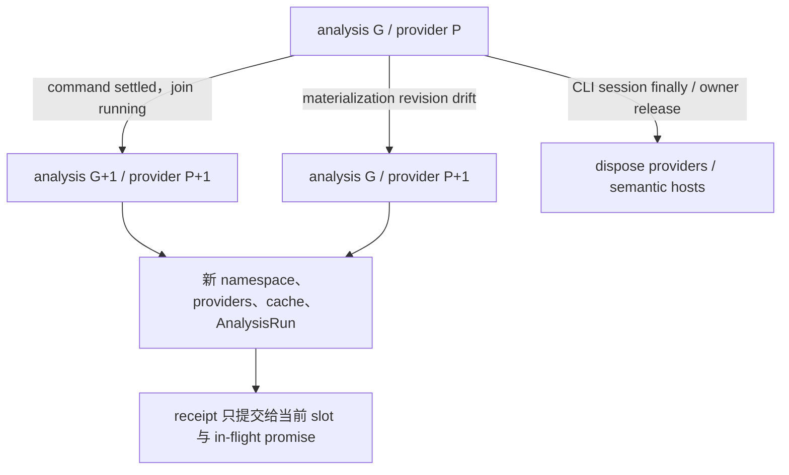

# Limina 生命周期与发布

[English](../lifecycle.md) | [简体中文](./lifecycle.md)

本页拥有 generation、cache、dispose、artifact mutation、migration 与 issue freshness 的完整解释。它们分别保护分析有效期、写入权限、发布完整性和结果新鲜度，不能合并成“所有状态都属于一个 generation”。

## Run、provider generation 与异步发布

[preflight manager](../../../packages/limina/src/preflight/manager.ts) 有 `#generation` 和 `#providerGeneration`。通常 command boundary 推进二者；materialization 因 base revision drift 触发 replan 时，只刷新 providers/namespace/cache，analysis task generation 保持不变。snapshot token 编入 root、两种 generation；数字本身不是物理文件版本。`ResolvedLiminaConfig.governanceRoot` 属于配置解析：最近 manifest 读取并验证一次，然后由根分类与根包构造共享。provider 刷新不产生第二份根 manifest fact，新的配置解析才建立新的根快照。该有界快照不冻结子包 manifest、整个文件系统或第三方工具的读取。

[executor](../../../packages/limina/src/execution/executor.ts) 是当前生产 generation controller 创建入口；[scheduler-loop](../../../packages/limina/src/execution/scheduler-loop.ts) 在 command settlement 标记推进后先 join running，再 startNextGeneration。manager 的 [materialization slot](../../../packages/limina/src/preflight/materialization.ts) 检查当前 slot 和 promise identity，防止旧异步结果覆盖新 receipt，失败后允许新尝试。命令可以改变 filesystem，因此不能只清一个查询结果继续复用旧 providers。

manager 保留 generated artifact application 的所有权。它的 `ensureGraphMaterialized()` 委托给 [materialization](../../../packages/limina/src/preflight/materialization.ts) 中的 `ensurePreflightGraphMaterialized()`，后者是 `materializeGeneratedArtifactPlan()` 唯一的生产调用方。[架构边界守卫](../../../packages/limina/src/__tests__/architecture-boundaries.spec.ts)检查两条调用边：helper 承担实现，但只有 manager 可以调用该 helper。这次提取不改变 generation 推进、replan authority、slot identity 或 receipt publication。

注入 custom providers 的 manager 只支持 generation zero；advance/replan 的检查发生在 dispose 和 replacement 之前，失败不会静默换成默认 providers。`dispose()` 幂等；但 manager 多数 `ensure*` 方法没有统一 disposed guard，不能宣称所有事后 API 调用都会被拒绝。生产调用方负责在 run 生命周期结束后不继续使用它；是否将该限制机械化是[审计风险](./architecture-audit.md#findings)。

Proof 声明验证必须经由[声明验证入口](../../../packages/limina/src/proof/declaration-config-findings.ts)继续传递当前 provider 的 project-config cache。漏传会让解析默认使用 generation zero，而生成图可能已持有后续 generation 的 Vue semantic identity，导致 provider 替换后的有效检查失败。[Proof 回归](../../../packages/limina/src/__tests__/proof.spec.ts)覆盖初始与下一 provider generation 的真实 Vue coverage；不兼容的 identity 仍会被拒绝。

释放责任必须沿调用链定位：[CLI check-run](../../../packages/limina/src/cli/check-run.ts) 与 [standalone](../../../packages/limina/src/cli/standalone.ts) 在 `finally` dispose session；[graph export](../../../packages/limina/src/graph-check/runner.ts) 只 dispose 自建 preflight，borrowed preflight/custom providers 的生命周期归 caller。较低层 [pipeline execution](../../../packages/limina/src/pipeline/execution.ts) 可自建 preflight，但没有统一 finally dispose；直接重复调用该内部 API 的生命周期不应借用 CLI 的保证。domain aggregate 的 immutable 视图也不改变这些实际所有权。

## Cache identity 与能力范围

| Cache / context                                                            | Key / lifetime owner                                                                                                                                                                          | Invalidation 与限制                                                                                                                                                                                                                 |
| -------------------------------------------------------------------------- | --------------------------------------------------------------------------------------------------------------------------------------------------------------------------------------------- | ----------------------------------------------------------------------------------------------------------------------------------------------------------------------------------------------------------------------------------- |
| Workspace、checker config、lookup、graph、route                            | [AnalysisProviderSet](../../../packages/limina/src/core/index.ts) 与 preflight promise/cache                                                                                                  | provider replacement 创建新集合；不能把一个 path-keyed map 作为全进程文件监控缓存                                                                                                                                                   |
| Region trie、canonical projection、exact classification、source config Set | [WorkspaceRegionPathIndex](../../../packages/limina/src/core/workspace/validated/path-index.ts) instance，由 workspace provider 的 getPathIndex Promise 共享                                  | provider-only replan 同样更换整个 index；不能只清 classification 而保留旧 trie/projection。[preflight regression](../../../packages/limina/src/__tests__/preflight.spec.ts) 在 analysis generation 不变时重绑 alias 并新增 boundary |
| Project dependency collection / preparation                                | [cache](../../../packages/limina/src/core/project-dependencies/cache.ts)：adapter、family、config/options/raw refs/roots、generation、package/resolver/framework identity、workspace boundary | final collection 再含 workspace export policy identity；有 callback 却无 identity 时禁用 final cache；返回 clones 防调用方污染缓存                                                                                                  |
| Native facts snapshot                                                      | [identity](../../../packages/limina/src/core/typescript-semantic/identity.ts)：config/options/roots/raw references/admission boundary                                                         | dispose 前复制完整 occurrence、resolution、closure 和 requirement facts。持久化复用另行验证文件版本及查询观察；仅有 context identity 不代表结果仍有效。                                                                             |
| Native dependency context                                                  | [入口](../../../packages/limina/src/core/typescript-semantic/index.ts) → Coverage-bounded Program                                                                                             | 冷采集后释放 Program；已验证 DTO 恢复无需 Program。Pending/locked 身份独立；不保留 oldProgram。                                                                                                                                     |
| Vue                                                                        | [manager](../../../packages/limina/src/core/vue-semantic/context-manager.ts) 与 process-wide active context slot                                                                              | 同 identity 可共享 owners；切到不同 identity 会替换并 dispose 旧 slot；last owner release 回收。不是每个 provider 独占一份长期 Vue Program                                                                                          |
| Astro                                                                      | [context](../../../packages/limina/src/core/astro-semantic/context.ts) 按 project seed/toolchain 管理，Program lazy                                                                           | snapshot 结合当前 source text；manager dispose 回收 context。外部文件变化仍受整体 provider lifetime 限定                                                                                                                            |
| Svelte                                                                     | [context](../../../packages/limina/src/core/svelte-semantic/context.ts) 单 active project，project identity 含 adapter/options/config closure/package/files/generation/profile                | leaf-owned toolchain；per-file sourceText 缓存与 managed lookup identity 分开；不是通用增量 watcher                                                                                                                                 |

Native 建图按 context 创建物理截断 Program，不按 occurrence 创建；完整 inventory 由编译器产生。Pending baseline 与 locked 事实分别采集，coloring/promotion 不修改已冻结语义。编译器对象在依赖采集构造完成后释放；返回的复制数据保留历史，不授予新 epoch 资格。显式 TypeEvidence 的 Program/Symbol 按需创建且单独计时。完整 DTO 恢复、冷采集和最终 Checker build 必须分别计数。[Native 增量回归](../../../packages/limina/src/__tests__/native-context-incremental.spec.ts)和[独立进程缓存回归](../../../packages/limina/src/__tests__/full-analysis-cache.spec.ts)保护删除入口、负候选出现和恢复边界。

运行期 project dependency identity 包含 compiler options/conditions、源码文件、authority、extensions、package roots、workspace boundary 与 generation。Native fact cache 也以该 project identity 为键。证据快照在收集与缓存边界复制并冻结，不保留 live framework profile。只有已经观察到的 runtime evidence 才会被复制，克隆不会解析模块。[Project dependency 回归](../../../packages/limina/src/__tests__/project-dependencies.spec.ts)覆盖上下文变化、修改尝试、原生 resource 及框架生成 observation。

Occurrence 快照保留 workspace boundary identity 的 SHA-256 摘要，并以不可变 boundary 对象为键在 WeakMap 中记忆。原始 identity 包含完整路径清单；每个 occurrence/cache clone 都深拷贝该清单，会使内存随 workspace 大小与 import 数量的乘积增长，并曾在仓库验证中耗尽默认 4 GiB 堆。有界快照回归使用 10,000 个 workspace 路径；成员集合不同仍会同时改变 boundary 摘要和 project identity。WeakMap 不会延长已释放 boundary 的生命周期。

[FileOwnerLookup](../../../packages/limina/src/core/build-graph/file-owner-lookup.ts) 的 lexical/canonical 索引与 realpath cache 限于当前 analysis/provider 生命周期。新 provider generation 与 replan 从各自 membership 输入新建索引，缺失或已重绑路径不借用旧 generation 的 owner。它不是 filesystem watcher，也不保证跨任意原地文件编辑的缓存有效性。

**Derived**：仅限运行期的缓存适合受控 run/provider 生命周期。若外部调用者跨文件编辑复用同一 cache/request generation，source content 不在 key 中就可能复用旧结果；这不是现有 CLI 必然 stale 的证据。要支持长期 daemon，必须先定义 mutation/version contract，不能简单扩大缓存寿命。

## 单次分析内的读取

`limina check` 是一次性命令，不承诺观察执行期间由编辑器、用户或外部进程造成的文件修改、删除、创建或修改后恢复。有界分析可以复用首次读取结果；这既不是冻结文件系统，也不是整次命令的原子快照。既有输入／配置漂移检查、发布前校验与错误传播在检测到变化时仍然生效。Memo 命中不会额外读取、stat 或 hash，以恢复对外部编辑的偶然可见性。

[物理文件回执](../../../packages/limina/src/utils/physical-file-identity.ts)绑定 canonical path、设备/inode、大小、修改时间与当前字节的摘要。元数据变更时间不能代表语义变化：另一个 pnpm 安装可能为同一 store 文件新增或移除硬链接，而输入本身没有变化。内容摘要仍拒绝恢复修改时间后的等长字节修改；文件替换与路径绑定检查保持独立。每次物理身份重放都会重新读取字节，不跨 invocation 缓存摘要。[生命周期回归](../../../packages/limina/src/__tests__/analysis-cache-lifecycle.spec.ts)覆盖硬链接创建／移除、实时及持久化回执重放、同 mtime 的字节修改与内容恢复。

[Epoch 重放](../../../packages/limina/src/core/analysis-cache/epoch-inputs.ts)对每次重放的读值及其当前物理绑定计算一次 observation。回执比较与紧接的登记使用同一个 observation，之间没有 await 或用户回调。登记仍拒绝与已有 observation 的冲突。独立重放与最终稳定性边界都会重新读取并校验输入。执行前置检查只可在[受管执行准入](#受管-checker-的执行准入)定义的明确只读阶段内复用 observation；副作用始终要求重新校验。[生命周期回归](../../../packages/limina/src/__tests__/analysis-cache-lifecycle.spec.ts)覆盖同步／异步重放、后续内容变化及已有观测冲突。此修改仅消除单次校验步骤内的重复计算，不增加保留状态，也不改变持久化回执身份。

| 复用输入                              | Owner 与首次读取                                                                                                                                                                                                                                               | 有效期终点                                                                                                                                                                    |
| ------------------------------------- | -------------------------------------------------------------------------------------------------------------------------------------------------------------------------------------------------------------------------------------------------------------- | ----------------------------------------------------------------------------------------------------------------------------------------------------------------------------- |
| 成功读取的 Vue 脚本文本，包括空字符串 | [VueSemanticContext](../../../packages/limina/src/core/vue-semantic/context-handle.ts) 在 ScriptSnapshot 旁持有按路径索引的文本 map。首次读取使用原 overlay system；同步过程仍更新／注册脚本并生成虚拟代码。**不缓存缺失结果**，读取抛错直接传播，不添加条目。 | 实际 context dispose 时清空 map。进程级 slot 可以有多个 manager owner；释放一个 owner 不会清空仍由其他 owner 持有的 context。Identity 替换或最后一个 owner 释放时才 dispose。 |

内部变化仍属于支持范围。生成配置经过既有 artifact／overlay 路径准备；checker 声明构建保留独立 host。Materialization replan 和分析重试即使不推进 analysis generation，也会替换 providers 及其 project-config cache。Provider generation 参与 Vue identity，因此新输入视图不能沿用旧 active context 的 memo。最后一个 owner 释放后，即使 identity 相同，也从新文本开始。Virtual overlay、config/options 和工具链身份继续保持既有隔离；该文本 memo 不新增进程全局表或持久字段。独立的 Vue 持久化适配器记录分析 DTO 和输入 receipt，不保存这份运行期文本 memo。漂移检查与持久输入观测保留原有校验规则。

[Vue 回归](../../../packages/limina/src/__tests__/vue-semantic.spec.ts)覆盖成功／空文本读取、缺失／错误重试与最后一个 owner 释放；[preflight 回归](../../../packages/limina/src/__tests__/preflight.spec.ts)覆盖真实 provider-only replan 和物化输入。后续独立命令按既有持久缓存失效规则读取当前输入；这份局部文本 memo 不新增跨命令新鲜度或速度保证。

[Astro 脚本同步](../../../packages/limina/src/core/astro-semantic/context.ts)复用 context 所属成功 snapshot 中的文本，包括空文本。Volar 会在重复请求时同步已注册脚本；再次读取会在有界 Program 准备期间重复执行文件系统和输入绑定工作。首次读取，包括 context 构造期间的读取，仍通过既有 analysis-input 回调记录观测。Memo 命中不额外读取或检查绑定；已记录的回调仍在独立稳定性边界重新读取。缺失和抛错读取保持可重试。Generation／context 替换及 dispose 会丢弃 snapshot；不增加进程全局或持久文本缓存。[真实工具链回归](../../../packages/limina/src/__tests__/astro-semantic-toolchain.spec.ts)覆盖真实 Volar 下的重复读取、Astro 虚拟脚本、空文本、缺失／错误重试、后续漂移拒绝，以及替换或释放后的新文本读取。

Vue 声明闭包投影仅在一次[支撑贡献收集](../../../packages/limina/src/core/project-dependencies/support-contributions.ts)内保留 occurrence 到 dependency 的索引。每条追加依赖沿用既有 occurrence identity，只入索引一次；重复 identity 保留首个匹配项。声明支撑收集仍先解析并追加依赖，再执行查询；缺失 fact 保持既有 incomplete 或 unresolved 结果。索引随本次收集结束而释放，不跨配置、provider 或调用共享。[项目依赖回归](../../../packages/limina/src/__tests__/project-dependencies.spec.ts)保护首项顺序、不同 occurrence 位置及独立收集；[图回归](../../../packages/limina/src/__tests__/generated-graph.spec.ts)覆盖 Vue 声明遍历中追加的依赖。

## 原生持久化分析缓存

Native／Vue snapshot 将声明解析 receipt、结果与类型环境入口一起保存。Adapter identity 使旧解释失效，缺失或不兼容的必要 receipt 触发重新分析。每次收集按当前根 membership 与入口可达性决定治理投影，包括无 membership 的负向判断。Manifest 内容、symlink 绑定、有效 types／typeRoots、声明内容和失败候选仍属于观察输入。删除最后一个合法本地入口时撤销内部贡献，其他合法入口仍保留共享贡献。更新使用现有项目替换生命周期，不扩大 `replaceProject` 的事务范围。

`check` 通过 [AnalysisCacheController](../../../packages/limina/src/preflight/analysis-cache.ts)请求本地分析快照。`check [pipeline] --force` 跳过既有持久化模型，执行冷分析，并通过正常发布路径发布本次具备资格的结果。它只阻止跨调用语义恢复；provider 刷新仍可复用本次调用内已验证的内存数据。由于 issue query 不执行分析，[CLI 入口](../../../packages/limina/src/cli/register/check.ts)在配置求值或创建 preflight 前拒绝 `--issues --force`。

公开 `cache?: boolean | CacheOptions` 默认启用。对象形式要求 `dependencies: string[]`，接受空数组，拒绝其他字段；旧顶层 `configDependencies` 会报错。[加载器](../../../packages/limina/src/config/loader.ts)绑定执行元数据时保留自有属性描述符，因此非枚举的 `cache: false` 仍会禁用持久化，枚举可见性也继续参与配置版本计算。统一 [preflight 创建边界](../../../packages/limina/src/preflight/setup.ts)在构造控制器前应用 `cache: false`，覆盖调用者的 `analysisCache: true` 和 `read-only`。禁用后不读取、不发布分析 snapshot，即使带 force 也不改变已有 snapshot 字节及 mtime；执行期缓存、配置观测／漂移保护、issues 和独立产物仍正常工作。内部 `analysisCache: false` 与 `read-only` 控制仍保留。`cache: true` 不会为原本未请求控制器的命令创建控制器。

checker 的 `.tsbuildinfo` 等构建缓存和 check-result query 保留各自合同。独立 graph/source 入口可读取有效分析数据，但不获得发布权限，其 CLI 参数保持不变。

[Cache identity](../../../packages/limina/src/preflight/analysis-cache-identity.ts)绑定 adapter、实际 compiler/checker/resolver 文件、host 语义、配置入口和治理根。实际模块所属包的 manifest 是工具观测输入，包括字节与绑定；内嵌 migration 不会仅为缓存身份要求安装 Limina 包。[工具观测](../../../packages/limina/src/preflight/analysis-cache-tools.ts)每次调用捕获一次文件字节及绑定，再在消费和发布边界复查绑定、package-scope 选择与元信息。[Context identity](../../../packages/limina/src/core/analysis-cache/identity.ts)绑定 effective compiler options、原始 references、admission 及 pending/locked checker identity。运行时 generation 和完整 workspace 清单不充当 importer version。

[文件摘要](../../../packages/limina/src/utils/file-digest.ts)使用有界缓冲区读取全部字节，供工具和受管 Checker 身份校验使用。每个既有证明边界仍重新读取所需文件，保留实际长度、链接、inode 和路径绑定证据；不使用 mtime 快捷判断或跨调用摘要缓存。[摘要回归](../../../packages/limina/src/__tests__/file-digest.spec.ts)覆盖分块边界、末尾字节变化、硬链接和符号链接。

[安装元数据 YAML](../../../packages/limina/src/core/analysis-cache/installation-files.ts)仅在同一 AnalysisInputs 内按内容 inputId 和 expectedVersion 复用解析结果。每个消费者仍通过原读路径观测当前字节、保留绑定 receipt，并取得独立副本。缺失或格式错误不产生可复用的成功解析；新调用重新解析。[元数据回归](../../../packages/limina/src/__tests__/installation-files.spec.ts)覆盖解析次数、调用方隔离、相同 mtime 下内容变化及消费后的漂移拒绝。

[安装环境](../../../packages/limina/src/core/analysis-cache/installation-environment.ts)区分 `observed`、`lockfile-trusted` 和 `unknown`。相关 lockfile 未变化，允许信任其覆盖的 types/lib 安装环境。这是工程信任合同，不是安装字节必然相同的证明。锁文件未变的未观测补装、手工修改及安装方式切换属于已接受边界；实际观测到的不同仍遵守失效／漂移规则。任一相关锁的内容、存在状态或绑定变化，使本配置的解析、native facts 及派生图失效；独立有效的语法、checker `.tsbuildinfo` 和其他治理域仍分开管理。

[安装绑定](../../../packages/limina/src/core/analysis-cache/installation-bindings.ts)从实际物理安装域、包管理器身份和消费项目范围出发，观测选择候选、manifest 和安装设置，不任选仓库根锁。pnpm 成员容器只有在祖先 workspace 与已安装 pnpm 标记一致，且所选 lock 覆盖该成员时，才继承共享安装；更近的独立 lock／安装边界阻止继承。裸 `node_modules` 根也属于安装根，其内容不进入本地目录指纹。受限适配器支持 pnpm 6/9 锁格式的共享、独立和自定义锁位置；简单当前分支锁记录实际 Git HEAD 输入。合并／detached 分支绑定及冲突的项目级锁设置明确回退 unknown。npm 2/3 格式要求覆盖项目条目，旧格式 1 仅支持安装根；同时观测 shrinkwrap 与 package-lock 候选。Yarn 物理 host 要求 classic v1，或通过门槛的现代锁格式、workspace 覆盖及 `nodeLinker: node-modules`；PnP／自定义 host 不获得 native 缓存资格。Bun 文本格式 1/2 要求 workspace 覆盖；二进制 v0 使用字节版本和可用的已安装 Bun decoder，仅支持安装根覆盖。缺失／不可读锁、未知版本和未证明的覆盖不能授予 clean 命中；既有冷分析能力保持有效。 相同所选文件、字节版本及 lock／解析根可共享成功的 pnpm 覆盖校验。[恢复](../../../packages/limina/src/core/analysis-cache/installation-lock-coverage.ts)在普通配置、输入及 consumer 覆盖校验后，仅从完整且 lockfile-trusted 的 context 恢复正向校验。安装 adapter v2 记录实际 lockRoot，跨记录校验要求所选锁的字节 receipt；该安装域的每项依赖必须仍然有效。分析 adapter v17 拒绝旧记录，因此首次调用会重建缓存。每个调用方仍选择当前绑定、读取完整锁字节并观测其版本后才能使用证明；变化的字节、根或绑定不能借用其他证明。失败或 unknown 校验不参与恢复。重复依赖校验直接将当前已观测记录与 expectedVersion 比较，不省略后续漂移检查。Native cache 的 Program 计数只覆盖符合资格的 context；评估整条命令时，必须同时统计框架回退的 bounded 和 provider Program 指标。

[pnpm 锁覆盖校验](../../../packages/limina/src/core/analysis-cache/installation-locks.ts)接受受支持的单文档锁，以及[先环境、后项目的官方双文档布局](https://pnpm.io/lockfile)。只有最后的项目文档能证明 workspace importer 覆盖，不将环境文档的 importers 合并进去。两个文档均须无解析错误，且使用相同的受支持版本。损坏或缺失的 importer 记录、仅环境文档、顺序颠倒及无法证明的布局仍为 unknown。继续观测完整原始锁文件字节和文件系统绑定，因此仅环境文档变化也会使旧 native facts 与上下文失效。[锁格式测试](../../../packages/limina/src/__tests__/installation-locks.spec.ts)覆盖拒绝的表示形式；[原生恢复测试](../../../packages/limina/src/__tests__/full-analysis-cache.spec.ts)保留成员成功恢复、环境字节失效和独立安装边界。

保留按 TypeScript 解析语义生效、有序且含继承路径的 typeRoots 清单。[本地指纹](../../../packages/limina/src/core/analysis-cache/directory-fingerprint.ts)递归记录路径、条目类型、普通文件 mtime、缺失／空根及链接／路径身份，排除 node_modules 内容。不读取全部文件内容 hash，也不以父目录 mtime 代替递归扫描。所有纳入的条目均参与，包括未消费及旧时间戳文件。共享目录仅在同一观测轮次复用扫描，后续消费／发布边界重新检查。根变化撤销对应共享语义环境，并通知全部配置订阅者；目录外声明依赖仍独立版本化。同路径内容变化但保留／回退 mtime 可能逃过指纹；仅 touch 可保守触发语义工作。扫描失败是错误，不能视为空目录。

[Inputs](../../../packages/limina/src/core/analysis-cache/inputs.ts)分开保留事实的 expectedVersion 和当前输入表。更新的内容 mtime 触发读取／hash，相同字节不制造内容变化；发布不推进未触碰输入的 checkpoint。存在性、目录、路径和 failed-candidate 观测继续独立生效。manifest 精度仍仅限有序 `imports`／`exports`；字段存在状态、其他解析内容、创建／删除、绑定或覆盖不完整走整域回退。没有 typeHash 或其他 manifest 字段级优化。正常 NodeNext／Node16 包含实际 importer scope 探测和 mode 前提，不将保存的 mode 当成常量。

[配置加载](../../../packages/limina/src/config/loader.ts)在每个独立 CLI 进程中求值当前入口及实际加载的模块闭包，为该命令捕获独立拥有、深冻结的纯数据。Native 加载根据 Node 实际返回的入口格式，为 CommonJS 选择 `require`。[配置模块证据合同](#配置模块证据)规定启动准入、loader 覆盖及不支持通用同进程热更新的边界。求值后未声明／未观测的外部输入变化，不停止或重载本次命令；下个 CLI 进程使用重新求值的结果。[有效配置版本](../../../packages/limina/src/config/analysis-version.ts)将全部用户配置属性及其枚举可见性纳入统一 `configVersion`，不建立配置字段到缓存层的影响矩阵。属性值相同但 enumerable 标志不同，可能选出不同的有效 checker，因此可见性必须参与版本。版本不同，逻辑失效该配置 namespace 下整个分析模型，包括解析、native facts、环境、贡献、ownership／provider 投影、图与索引。独立 checker 缓存、`.tsbuildinfo` 和其他配置 namespace 保持独立。版本相同仍继续所有普通增量输入检查。新 `cache` 字段参与这一既有版本机制；省略与显式 `true` 的执行策略相同，但表示方式变化可以保守地触发首次 cold。不引入 snapshot schema 迁移或清理。持续函数／闭包、Proxy 及自定义原型数组保留为可执行或不透明值；版本无法稳定表示时冷分析，不恢复或发布跨调用模型，不通过丢弃函数制造相等。已观测配置代码／模块／治理绑定漂移终止调用，不重放 pipeline。[调用期观测](../../../packages/limina/src/preflight/config-observation.ts)也保护已加载配置，即使持久化缓存读写被关闭。显式本地文件输入使用`cache.dependencies`，不增加通用 JavaScript I/O 追踪。

公共配置分组迁移保留快照 schema 和存储布局，只更新[分析实现身份](../../../packages/limina/src/core/analysis-cache/contracts.ts)。旧实现快照在原有 identity gate 被拒绝后按需冷启动，避免恢复旧配置路径的诊断；即使用户配置是空对象也适用。不清理其他命名空间或 checker 缓存。全部新域仍由统一有效配置版本覆盖，`cache.dependencies` 的配置目录基准、模块观测、缺失／链接失效及调用期漂移规则不变。

配置校验在恢复分析缓存前完成。无效配置不能采用或替换既有快照；恢复有效配置后，可以在普通输入检查通过时复用该快照。原生 context 和生成图的 DTO 保存 TypeScript 选项与依赖事实。有效的 TypeScript `customConditions` 变化会改变原生 context 身份。[完整缓存回归测试](../../../packages/limina/src/__tests__/full-analysis-cache.spec.ts)通过正向恢复控制覆盖配置准入和原生选项失效。

[Context records](../../../packages/limina/src/core/analysis-cache/context-records.ts) 与 [graph records](../../../packages/limina/src/core/analysis-cache/graph-records.ts) 在创建 Program 前校验普通 DTO。完整 clean 原生路径恢复 facts、成员、共享环境、ownership、occurrence 贡献及图投影，不创建分析 Program，不重复关系推导，也不额外完整枚举受信安装类型环境。runtime/resource evidence 和当前判定保留自己的有效性与刷新路径。恢复的生成内容取得新的认证 [artifact plan](../../../packages/limina/src/core/build-graph/analysis-cache.ts)，缺失／变化产物走正常物化。Program、AST、Symbol、host 及写权限不持久化。

Vue 适配器共用上述输入、配置、lock coverage、epoch 和发布门。Schema 10 保存中立文件事实、收集方式、完整 Vue context／query receipt、图中的 context 引用，以及分别校验的类型入口／输出投影证明；旧快照冷回退，不迁移或删除。[Vue 输入观测](../../../packages/limina/src/core/analysis-cache/vue-inputs.ts)包装物理 compiler host。Volar 的虚拟声明 realpath 回退记录物理缺失状态和路径绑定，不将虚拟文件视为真实存在。构造 Volar project host 时不修改解析所得的 options 对象。Clean 混合图将 Vue identity 绑定至当前 provider generation，并创建新的 artifact plan，无需取得 Vue Program 或重新推导图。资格与不支持的 provider 边界见[语义有效性](./semantics.md#持久化-importer-有效性)。

Vue 完整图恢复先重新绑定已合格的 context，再通过[生产者共用的引用投影](../../../packages/limina/src/core/build-graph/cached-vue-references.ts)核对声明引用。该校验复用有效 Vue query facts，保留声明闭包、资源观察、implicitRefs 和 provider 选择语义。根文件来自当前解析配置；缓存根文件、图边和 admission 不授予资格，也不把缺少 Native required relation 当作没有 Vue 引用。引用重建是恢复验证的一部分，不重做整个 ownership／图构建。跨项目导入移除会重新分析并删除最后一条引用；互相一致但擦除了合法引用的缓存候选仍被拒绝。[Vue 缓存回归](../../../packages/limina/src/__tests__/vue-analysis-cache.spec.ts)保护这些正反例。

Vue 输出 context 具有独立 identity 及观察输入／查询回执；DTO 记录保留源配置路径和有效输出选项。恢复时使用当前工具链重新解析源配置、重建输出 identity，并在接受输出投影前校验其自身输入、选项及 roots。生成配置是否存在不构成 identity 权威，源 context 不能满足输出回执。[Vue 缓存回归](../../../packages/limina/src/__tests__/vue-analysis-cache.spec.ts)覆盖无分析 Program 的新进程恢复、生成配置缺失、输出 target 失效，以及回执错误绑定源 context 的负例。不支持的自定义插件和虚拟输入继续采用既有冷回退。

Discovery glob 回执比较返回路径 membership 的排序副本，不修改 reader 结果或 pattern 顺序。异步枚举顺序本身不能制造调用漂移或拒绝持久化图恢复；成员增删、路径绑定和全部非 glob 值继续精确校验。[生命周期回归](../../../packages/limina/src/__tests__/analysis-cache-lifecycle.spec.ts)覆盖乱序 live observation、glob 回执重放、真实 membership 变化和有序非 glob 读取。

Clean 调用仍先校验全部旧输入，再由[失效传播](../../../packages/limina/src/core/analysis-cache/invalidation.ts)决定是否需要反向订阅。没有版本变化时不构造反向索引，源码版本检查仍执行。任一输入变化时，先从正向记录构造完整索引，再传播解析及共享环境失效。此优化改变分配成本，不改变依赖权威或失效范围。

[Vue 查询 memo](../../../packages/limina/src/core/analysis-cache/vue-memo.ts)属于单个分析缓存实例。每个通过资格检查的身份对象只计算一次持久化 context key；capture 重新检查完整数据身份、generation、运行时身份 ID 及无 overlay 条件，遇到漂移会在发布前拒绝继续。新 provider 身份独立绑定。查询结果通过校验后才保留解码结果，编码记录冻结，返回调用方的值始终独立复制。整域失效仍阻止查询复用。[Memo 回归测试](../../../packages/limina/src/__tests__/vue-analysis-memo.spec.ts)覆盖操作次数、调用方隔离、不同身份、整域失效及内存身份漂移。自定义 Vue 插件和 Astro/Svelte 继续冷回退。

[快照可达性](../../../packages/limina/src/core/analysis-cache/snapshot-reachability.ts)逐项将全部正向 query 和依赖 receipt 加入 Set，不再按重复引用总量展开临时数组。每次处理按 context 建立一次成员索引，避免为每个 importer 重建源码清单；索引不合并消费上下文。Unchanged 比较仍裁剪未使用的 importer、query 和输入，并比较保留记录的身份；配置输入、项目成员、manifest 和 contribution 的保留规则不变。不用摘要或 dirty flag 代替完整可达性检查。输入／配置稳定性、epoch、lease 和精确物理发布基线检查继续独立执行。

[Receipt 表](../../../packages/limina/src/core/analysis-cache/snapshot-receipts.ts)无损合并重复的依赖元组、query 标识和有界的有序 receipt 序列。每条事实保留独立的 `(inputId, expectedVersion)`，解码不以当前输入版本替代预期版本。序列共享保留顺序、重复次数及尾块。缺失表条目、无效索引和不兼容编码冷回退；解析仅共享经过私有验证且冻结的依赖元组。快照隔离通过带标签的数据 codec 逐条复制紧凑记录，再展开 receipt，不执行序列化、压缩或解压；保留完整值，包括 undefined 与有序 Map/Set 条目。Header／配置证据单独复制，表解析取得元组所有权，不与活动分析共享可变输入对象。磁盘字段采用规范排序，内存副本及 opaque compiler options、request、references 和 identity 数据保留语义顺序。可枚举 compiler-options 视图省略 TypeScript 的隐藏 AST 附件，不改变公开配置 descriptor。

[Store](../../../packages/limina/src/preflight/analysis-cache-store.ts)写入 `cache/analysis-v2/<config-key>/index.liminainfo`，并在 `scopes/<scope-key>/` 下存放内容寻址的 `.liminainfo` 块。Index 包含 schema 10 header、必需的 `configVersion`／`configModules` 及块摘要／长度。[分区](../../../packages/limina/src/core/analysis-cache/snapshot-shards.ts)按实际项目配置路径组织 native context、project、importer、query 和 Vue context；source 与生成的 declaration config 保持独立。完整中性 `files` facts、inputs、graph／contribution 记录及没有保留 context owner 的记录进入 shared 存储。分组清单从完整记录形状派生，新增记录种类不会被独立分区列表静默遗漏。每块拥有独立 receipt 字典。[Payload](../../../packages/limina/src/core/analysis-cache/record-payload.ts)对完整 JSON scope 数据使用 Node Brotli，并限制声明的解压长度。JSON 保持原有 undefined 字段／数组槽处理。缺失或损坏的块、无效 receipt、截断 payload 和不一致的模型覆盖均使整个模型冷回退，不信任部分图。

[Bounded 证据关联](../../../packages/limina/src/core/analysis-cache/bounded-evidence-index.ts)在每次同步资格校验内建立 request、resolution 和 obligation 查询表，并只计算一次预期 context 指纹。同次校验中的 fact 与 obligation 共享按完整目标身份推导的 Coverage。重复标识、缺失成员、context 来源、Coverage 与 obligation 证明仍受检查。局部索引不授予可变 DTO 持久资格，也不跨恢复边界复用。[Native 恢复测试](../../../packages/limina/src/__tests__/native-context-incremental.spec.ts)在 DTO 校验成功后修改成员版本和解析目标身份，要求再次校验与采用均拒绝该数据。

[带标签数据校验](../../../packages/limina/src/core/analysis-cache/data-codec.ts)遍历与解码相同的语法，在完整模型校验时不构造随即丢弃的图副本。元组长度、标量类型、有限数字、嵌套条目和 object／map 重复键检查均保留。后续恢复仍独立解码图。[Codec 测试](../../../packages/limina/src/__tests__/analysis-data-codec.spec.ts)在两个入口比较合法嵌套值与畸形编码；该优化不跳过 schema 或语义资格校验。

恢复在读取任何旧块前先校验小型 index。Identity／schema／配置版本／模块证据不匹配以及 force 均跳过全部旧 scope 块。合格恢复仍加载全部引用块并验证完整模型，之后才采用普通输入；这不是按 consumer 延迟恢复。当前 provider／ownership 身份、输出回执、query 覆盖和全部原有输入／新鲜度检查继续有效。存储 scope 不授予合并语义上下文的权限。

发布保留授权 namespace、跨进程 lease、输入／配置／epoch 检查及精确物理 index 基线。[块 I/O](../../../packages/limina/src/preflight/analysis-cache-blocks.ts)先验证内容再复用，先写块，最后完成漂移与基线检查后才原子替换 index。中断发布后旧 index 仍可用；旧 writer 不能替换较新 index。未变化块保留字节与 mtime。严格 clean 发布仍检查输入，不 clone 或序列化模型。Provider 刷新不更新 writer 基线。旧 `analysis-v1` 数据既不导入也不删除；发布不回收不可达块，独立 GC 必须保护持有旧 index 的 reader。活跃引用字节与总保留存储量须分别报告。存储 I/O 失败可省略更新；观测、漂移和权限失败继续传播，包括携带 filesystem code 的错误。

未变化模型的发布只校验一次输入。模型变化时，在取得写锁后和原子替换 index 前分别检查当前输入；controller 不再在这些检查之前增加重复扫描。只读、无发布资格和缺少物理基线的分支即使不发布，也继续校验本次调用的输入。[生命周期回归](../../../packages/limina/src/__tests__/analysis-cache-lifecycle.spec.ts)保留晚期漂移拒绝和存储错误边界。

实现复用 Node compression／crypto、既有 DTO codec、namespace、原子 writer 和 lease owner，不新增依赖或第二套语义权威。[存储回归](../../../packages/limina/src/__tests__/analysis-cache-shards.spec.ts)、[Native context 恢复](../../../packages/limina/src/__tests__/native-context-incremental.spec.ts)、native／Vue 恢复及配置／进程测试保护各自边界。存储体积减少本身不能证明完整命令延迟或峰值 RSS 改善。公开配置变化仍执行 namespace 级有效版本失效和[分析实现身份](../../../packages/limina/src/core/analysis-cache/contracts.ts)检查，不清理其他 namespace 或 checker 缓存。配置目录相对 dependencies、模块观测、missing／link 失效及 invocation 漂移规则不变。

Force 读取保留精确物理基线，不解码、校验或恢复旧模型。旧模型 revision 不可用于 unchanged 发布快捷路径，因此具备资格的冷分析结果继续经过与普通发布相同的 lease、输入／配置稳定性检查、基线比较及原子替换。Force 不绕过 `configuration-version-unknown`，也不为可执行配置授予持久化资格。

修复信任边界之外的安装变化时，运行 `limina check --force`；指定配置时加上 `--config <path>`。它按当前项目状态刷新分析快照，后续普通 check 可恢复新模型。不删除快照、缓存目录、issue 结果或 checker `.tsbuildinfo`，也不要求强制 TypeScript checker 构建。store 仍根据解析后的绝对配置路径计算 key。

分析漂移最多以新 provider、TypeScript 项目配置解析和成员发现重试一次，继续使用本次冻结的 Limina 配置；事务仅包含分析／候选规划，不重放 checker、命令或产物写入。输出变化保留物化／replan receipt 协议。迟到 epoch 结果不能提交，旧的同 context 实例 dispose 不能释放替代实例。

[生命周期回归](../../../packages/limina/src/__tests__/analysis-cache-lifecycle.spec.ts)、[语义回归](../../../packages/limina/src/__tests__/analysis-cache.spec.ts)及[完整缓存回归](../../../packages/limina/src/__tests__/full-analysis-cache.spec.ts)挑战这些合同。`LIMINA_PROFILE=1` 分别记录 context／graph 恢复、证据来源、probe／scan、读取／hash、Program、native query、投影、clone 及发布。本地测试不证明 Windows／Linux 行为或仓库整体提速。

### 配置模块证据

支持的执行模型是每个 Node 进程运行一次 CLI 命令：进程 A 求值配置、冷分析并发布快照；进程 B 求值当前配置，独立校验快照后才恢复分析。[公开 API](../../../packages/limina/src/index.ts)不暴露 `loadConfig`，重复调用内部加载接口不构成模块热更新合同。“每次 invocation 重新求值”指新的 CLI 进程，不要求清空嵌入应用的全部 CJS／ESM 模块和解析缓存。不持久化求值后的配置对象。单次命令内，已观测配置漂移仍必须在继续使用或发布前中止；cold 不能修复已经过期的配置求值，也不能重放命令。

[加载观测](../../../packages/limina/src/config/input-observation.ts)记录当前字节、实际 mtime、逻辑／物理绑定、治理锚点及成功解析的原始请求、目标、条件和属性。[模块比较](../../../packages/limina/src/preflight/config-module-comparison.ts)在采用旧模型前校验 loader identity、入口存在、成员、解析边、绑定和逐文件内容。模块或边变化，即使求值结果相同，也使整个配置 namespace 失效。退出闭包的 helper 只属于旧比较证据，不成为本轮漂移目标。source／checker 的 `tsconfig + extends` 观测保持独立；旧快照不决定本轮加载闭包。

[逐文件构造](../../../packages/limina/src/preflight/config-module-snapshot.ts)在实际 mtime、绑定和文件类型相同时复用磁盘内容 hash。mtime 不同，包括回拨，仅用已捕获字节 hash 该文件；touch 后内容相同仍可复用。恢复时间戳和绑定可能掩盖内容变化，size／ctime 本身不触发 hash。严格调用内字节／绑定检查独立于跨进程 mtime 信任。纯 metadata 变化不改写 clean 快照的字节、revision 或 mtime。

[实际加载源码](../../../packages/limina/src/config/load-source.ts)区分与磁盘一致的源码和可观测 Loader 输出。模块记录携带源码来源；缺少源码仍为 unknown，没有受支持转换 Loader 时 native 源码替换仍为 incomplete。已观测转换输出使用独立逐模块摘要，每次加载重新计算；即使磁盘 mtime 相同，输出变化也拒绝恢复。`loaderSourceHashes` 和 `loaderSourceBytes` 暴露这部分成本，不持久化转换源码或语法分类。`evaluationMs` 包含 Loader 求值和 Hook 回调，`hookMs` 统计回调内的观测工作但排除被委托的 Loader，`observationMs` 统计求值之外的捕获、依赖注册和稳定性检查。这些时间区间存在重叠，不能作为独占阶段相加。

Runtime Hook 是一等依赖观测机制。配置加载／求值阶段的请求会被记录，包括父路径并未加载的 `createRequire()`；仅过滤已加载父模块会漏掉这种请求。在观测边界复制可迭代 conditions：Node 22.18.0 的 CJS 解析提供 SafeSet，Node 24.11.0 则提供数组；传给 Node 的原始 context 保持不变。保留原始 specifier，不从目标文件名反推，因此 `require('./foo')` 从 `foo/index.js` 改选 `foo.js` 会拒绝旧分析。配置工厂在 Hook 作用域内等待完成。执行到的变量 import 贡献实际解析边和模块，未执行分支不贡献依赖。不再使用 TypeScript AST 扫描、parser identity、动态导入站点列表或语法驱动警告。继续执行的回调／闭包和不透明值仍无法取得有效配置版本，也不能取得持久模型资格。Hook 注销后的导入不在自动覆盖范围内。删除语法表达式不自动提升 unknown：旧 incomplete 快照必须先经过一次 complete 冷发布，后续才可 warm。

[显式文件注册](../../../packages/limina/src/config/file-dependencies.ts)在求值后把启用缓存的对象形式中的 `cache.dependencies: string[]` 纳入同一 `ConfigLoadEvidence`、`ConfigModuleSnapshot` 和 `ConfigObservation`。声明不要求文件被配置代码实际消费。明确文件路径以选定配置文件目录为基准，允许绝对路径和上级路径。归一化声明保留逻辑绑定，并指向按物理路径合并的文件记录；已有模块角色保持不变。缺失文件、悬空链接、创建／删除、改指及声明集合变化均可观测；目录、glob、URL 和非法路径值会报错。声明内容变化使配置 namespace 失效，即使有效配置值相同。缺失状态和别名绑定与字节一起参与调用内稳定性检查，包括只读消费者及内部访问模式禁用持久化的命令。注册无法反向证明此前直接 `fs` 读取时消费的字节相同，外部生产者应在求值与检查期间保持输入稳定。

实现复用 Node 同步 `registerHooks`、文件系统／crypto API 和现有缓存所有者。Webpack 的依赖声明与逐文件快照是可参考机制，但引入其与 compiler 耦合的缓存、CJS `require.cache` 反推或 ESM 静态扫描会增加第二套事实来源，也不能保留原始请求，因此不新增包或通用文件系统 Hook。环境变量、网络、时间、随机值等非文件输入，只在其影响实际进入有效配置数据时受版本保护。隐藏行为沿用 unknown／cold 边界或使用 `--force`；不会推测扫描未声明的 `fs` 读取，也不因此拒绝所有普通配置。

[Loader identity](../../../packages/limina/src/config/loader-identity.ts)包含 backend、运行选项和已安装的 tsx 版本。Limina 通过公共注册 API 创建 tsx scope，只从持久化 URL 移除该注册的精确 namespace，用户 query／hash 和其他 loader mode 保留。注册保持存活以支持配置回调。Native 加载仍保留最小 ESM URL 隔离，因为 CLI 初始化可能已加载配置随后导入的公共库；tsx backend 使用自身注册 namespace，不叠加另一隔离参数。它提供 fresh load 证据，且不重复改写已隔离的 URL，使工厂导入自身 URL 时不会再次求值。不承诺嵌入进程内 Node package／realpath 解析缓存刷新。CJS 递归淘汰、进程级已观测路径注册表和私有 `_pathCache` 修改均移除。

普通 native CJS 在 Node 暴露实际加载源码且其他证据完整时可以恢复。[预加载 CJS 准入](../../../packages/limina/src/config/preloaded-commonjs.ts)拒绝检测到的已缓存配置入口／依赖，不把无法核实的缓存求值当作当前求值。`createRequire` 经同步 resolve／load Hook 观测，单独导入 `node:module` 不会使配置失去资格。Tsx CJS extension hook 可能绕过 Node load／源码观测，因此仍 cold；namespace 归一化本身不能证明完整。[CLI 配置边界](../../../packages/limina/src/cli/command-runtime.ts)在求值前拒绝无法识别的 Node 启动 `--require`、`--import`、`--loader` 及对应 `NODE_OPTIONS` 覆盖。Preload 可先填充 Node package 解析缓存再修改 manifest，此时仅 unknown／cold 仍会执行错误配置。仅当实际解析路径属于已安装的 tsx 包时支持该启动；不单凭包名信任。产品转换应使用 `--config-loader tsx`。任意嵌入和第三方 preload 组合不受支持。被 hook 观测到的程序化源码替换不能静默复用仅依据磁盘的摘要。不透明 scheme、未观测格式和重叠加载仍 incomplete；自动完整性仅限可靠观测到的模块加载事实，不覆盖所有 JavaScript 副作用。替换模块加载机制或启动未等待加载工作的配置不在受支持观测边界内；`cache.dependencies` 只为本地文件输入补充证据。

验收归属[模块／门禁测试](../../../packages/limina/src/__tests__/config-module-cache.spec.ts)、[生命周期测试](../../../packages/limina/src/__tests__/analysis-cache-lifecycle.spec.ts)和[真实 CLI 进程测试](../../../packages/limina/integration/tests/config-process-cache.spec.ts)。必须先有 warm 正控制，再分别破坏 schema／version／module／incomplete／content／binding／edge；断言应观察旧模型采用或 graph 恢复和 Program 数量，不能只检查最终输出。跨进程用例启动新 Node 进程并复用同一磁盘快照。Loader 可信性用例区分过期求值、不安全恢复和主动 cold。Force、issue-only 查询、禁用／只读缓存、分析失败、严格漂移、clean 发布和真实竞争 writer 保留原合同。性能比较须包含完整命令及加载耗时、磁盘／输出 hash、Program、快照读取／解析／校验／写入成本及体积；测试通过或磁盘零 hash 不证明整体提速或未经测试的平台兼容性。

## Provider-owned 原始语法复用

Native 生产入口不再持有独立 SourceSyntaxFactsCache 或 Programless 扫描器。编译器解析实际进入 frontier 的 SourceFile；runtime 收集器对调用方传入的当前 AST 观察源码请求，不按同一 text/path 借用另一份可能已被修改的框架 AST。[Import analysis 回归](../../../packages/limina/src/__tests__/import-analysis.spec.ts)保留修改 AST、shadowing、require.resolve 与 createRequire 的独立合同。

缓存内的中立文件事实结构仍由原存储 codec 所有，但不成为 Native 发现权威。首次发布及冷分析必须记录实际 bounded-program-create，不能因为 Native 不调用 TypeChecker 就报告零 Program。首版不复用 oldProgram，也不承诺只解析变化文件。后续内存复用须证明通道 inventory、贡献撤销、上下文和物理身份；不能只合并本轮 hook 日志。

性能按环境 × 工作负载 × 缓存状态分别测量：纯 Native、混合框架和仓库；冷分析、首次正常发布、新进程恢复、增量及 clean Checker build。计时样本不插桩，诊断 metrics 单独运行；保存逐次 wall/CPU、父子内存、Program/TypeChecker 与读取/解析/恢复/发布成本，并声明 OS/tsx 缓存状态。既定预算不可事后放宽，存储缩小或零 TypeChecker 都不证明端到端收益。

## Source 阶段观测

[Source phases](../../../packages/limina/src/source-check/phases.ts) 分离只读准备、Knip 执行/清理和只读 ownership/authority/reporting。Runner 在**现有整体 task 资源声明**下顺序执行。公开 task 仍是 `source:check`，最终 source 结果只发布一次。Knip 失败或清理错误仍阻止后续阶段发布成功。Phase wall 观测不授权其他读取方在 Knip 临时入口可见时并发扫描，也不削弱 manifest、repository、generated-file 或跨进程 lease 约束。

## Namespace、物理身份与 plan

[namespace-core](../../../packages/limina/src/domain/artifacts/namespace-core.ts) 记录 logical root、canonical root、generation token，并通过内部 WeakSet 认证；[artifact plan](../../../packages/limina/src/domain/artifacts/plan.ts) 也认证并关联同一个 token。相同 root 与 numeric generation 的两个新 namespace 不能互换 plan。生产 graph 生成 revisioned plan；内部 unrevisioned plan 构造入口存在，不能把 base-revision 检查泛化到每个 API 输入。

Generated config 身份相对 active workspace root 判定；更高目录里的 `.limina` 名称不应误伤嵌套 workspace 的 source config。[mutation authority](../../../packages/limina/src/utils/mutation/authority-create.ts) 对可信 base 取 canonical identity，检查 logical chain、scope 和 containment；输出定位不自动赋予 mutation 权限。

[identity checks](../../../packages/limina/src/utils/mutation/identity.ts) 使用 lstat/open/fstat、content/hash、device/inode、link/metadata 等组合验证 binding。逻辑 symlink/junction、物理 escape、binding drift 分别有拒绝路径。它们是具体执行 guard，不是对任何操作系统并发攻击都绝对无竞态的证明。

## Generated artifacts 的发布与恢复

生成的声明目录与增量缓存路径在既有 checker 和目录分区内保留完整源配置文件名，包括 `tsconfig.` 和 `.json`，因此 `tsconfig.json` 与 `tsconfig.tsconfig.json` 不再共享路径。规划阶段拒绝不同源配置占用同一路径。重新生成会更新受管配置；过期清理只依据原有所有权清单，不递归删除未登记的编译缓存或用户文件。[Namespace 守卫](../../../packages/limina/src/__tests__/artifact-namespace.spec.ts)与[图重新生成测试](../../../packages/limina/src/__tests__/generated-graph.spec.ts)覆盖路径冲突、旧所有权清单和重复规划。

[materializer](../../../packages/limina/src/core/build-graph/materializer.ts) 的生产路径：

1. 认证 namespace/plan；获得 canonical root 的跨进程 writer lease。
2. 在 lease 内读取 base revision。drift 时最多完整 replan 一次，要求仍是同一 canonical lease root。
3. 写入 in-progress marker，包含 base/desired revision 与 owned-path universe。
4. 写目标文件，删除不再属于目标的旧 owned paths；manifest 最后写。
5. 验证 desired tree 后删除 marker，才完成 receipt。

失败后 marker 保留，reader lease 报 recovery required；下一个 writer 用完整新 plan 恢复并验证后解除 marker。manifest-last 是协议的一环，不是 filesystem 多文件原子事务。恢复没有通用 journal 或 backup tree。Checker typecheck 在可能的重新规划完成后，从物化 receipt 选择目标，包括判断是否没有目标；其[读租约](../../../packages/limina/src/core/build-graph/materialization-read-lease.ts)在启动 checker 前检查当前产物 revision 仍匹配 receipt，漂移时明确失败并要求重新执行命令。Checker build、选定 checker build 和 managed output build 在编译器执行前使用同一 receipt/revision 握手。单独的 reader lease 不能授权旧的内存 classification 消费更新的 generated closure；其他无关产物消费者仍遵循各自协议。[回归覆盖](../../../packages/limina/src/__tests__/typecheck.spec.ts)在规划与物化之间改变 leaf 和 package root，并在取得读租约前替换 receipt。

[manifest version](../../../packages/limina/src/core/build-graph/manifest-version.ts) / [ownership](../../../packages/limina/src/core/build-graph/manifest-ownership.ts) 允许旧格式仅作为 cleanup ownership ledger；当前 schema 定义在生产 types。当前检查时为 v5，v1–4 不作为当前 graph 重用。future/非法版本拒绝。ordering 使用 code-unit comparison；运行时能力描述和 live source descriptors 不因此变成持久化 graph。

这套 namespace materialization 管的是 managed generated artifacts。graph export 的用户目标文件、`build --raw` 的外部工具输出和 migration 有不同 writer contract；不能写成“全部磁盘写入都经过 materializer”。managed checker output 另经 [managed-mutation](../../../packages/limina/src/typecheck/managed-mutation.ts) 与 [output](../../../packages/limina/src/typecheck/output) 校验 authority。

跨进程 holder 通过目录 rename 发布不可变、以 token 命名的 owner record。回收只删除观察到的 record，然后执行非递归 rmdir；替换 holder 的不同 record 会阻止其非空目录被删除。release 使用相同规则。清理中断留下的空已发布 slot 可以恢复；未发布的 reader candidate 不属于 reader membership，不能作为空 lease 被回收。旧 `owner.json` record 可以退役，但不再发布这种格式。这是当前 Limina 进程之间的协作协议；并发运行且递归删除 holder 的旧版二进制不在该协议内。[Lease 回收守卫](../../../packages/limina/src/__tests__/cross-process-lease-reclamation.spec.ts)在另一 writer 获得 slot 时分别延迟 record 删除与目录移除。

Holder 发布的 rename 返回 `EEXIST` 或 `ENOTEMPTY` 时已经证明发生争用；即使该 holder 在后续检查前释放，也应重试。要求它继续存在会把正常释放变成致命持久化错误，包括 check-index 发布期间。存在歧义的 Windows 风格 `EACCES`、`EBUSY`、`EPERM` 仍须以 holder 仍存在为依据；无关 I/O 错误必须继续传播。重试回到现有的有界获取协议，不绕过 owner 验证、失效 owner 回收或 latest-attempt 检查。[发布守卫](../../../packages/limina/src/__tests__/cross-process-lease-holder.spec.ts) 覆盖真实 POSIX 冲突后释放、两种明确冲突错误码对应 holder 已不存在，以及权限与其他错误对照。[并发 CLI 回归](../../../packages/limina/src/__tests__/cli.spec.ts) 拒绝持久化警告，并在查询失败时包含 stdout/stderr。这维护 I11 的发布完整性与 I12 的新鲜度；仅凭 CI 查询退出码无法确定发生了哪一种持久化失败。

独占 declaration publication 在写入、同步和回读前捕获新空文件的 identity。失败时保留该 identity 供回滚；未完成内容必须仍为预期字节的前缀，且 device/inode/mode/link count 相同。已验证文件保留完整 content-hash 检查。每个 parent directory 在创建下一级前单独加入事务 ledger，后续失败不能丢失此前的清理 ownership。无法读取 identity 或外部替换不会授予删除 authority。[Publication 失败守卫](../../../packages/limina/src/__tests__/output-publication-failures.spec.ts)注入 partial write、sync/readback 失败、目录失败和替换，并检查重试与用户文件保留。

## 受管 Checker 的执行准入

[Checker 实现身份](../../../packages/limina/src/typecheck/managed/identity.ts)保留可执行文件／包的字节、权限和物理／路径绑定，不纳入只读硬链接数量。并发 pnpm 安装可能改变这些数量，但所选工具没有变化。配置依赖回执和 mutation boundary 保留既有硬链接检查。[受管 mutation 回归](../../../packages/limina/src/__tests__/managed-mutation.spec.ts)允许实现别名创建／移除，拒绝命令／清单字节变化，并继续拒绝配置硬链接漂移。

[框架配置发现](../../../packages/limina/src/core/analysis-cache/framework-config-inputs.ts)先规范化 glob 与祖先查找得到的路径，再对 invocation 内的加载去重。Windows 分隔符差异或 dot segment 别名可能使同一个 CommonJS 模块加载两次，并将第二次求值误拒为预加载。去重保留原始字节、解析绑定和后续漂移拒绝。[准入回归](../../../packages/limina/src/__tests__/execution-admission.spec.ts)覆盖别名发现、初次正常启动及之后的配置导入漂移。

物化与执行各自拥有独立准入。诊断候选可以物化，同时适用的 `deny.refs` 阻止受管 Checker target 执行。[Execution Admission](../../../packages/limina/src/typecheck/admission/execution-admission.ts) 由受管 build 和独立的框架 typecheck pool 共用，在物化 revision lease 与当前输入证明下检查 mutation、launch、output-copy 边界。它不调用完整 `graph:check`，不改变 Core 完成状态，不删除关系，也不保证 Checker 最终成功。

[引用闭包](../../../packages/limina/src/typecheck/admission/reference-closure.ts) 从本次命令的实际配置开始。生成声明／输出配置的 alias 保留源配置与 Checker 身份。实际引用（包括传递 `implicitRefs`）决定可达性，依赖调度边不能替代它。solution 与 wrapper 只提供可达性，不满足声明义务，也不引入容器标签政策。框架源码命令使用自身 source config 和能力 context；schedule 不变成 Project Reference，也不选择额外进程。[纯引用治理](../../../packages/limina/src/graph-check/reference-governance.ts) 复用既有规则规范化、标签匹配、alias 与 finding，只裁定该执行范围内适用的 `deny.refs`。规则规范化认识所有合法 Checker 映射，匹配仍针对当前边；无关的合法跨 Checker 规则目标不是 unavailable 映射。

拒绝以实际进程 target 为单位。单个命令覆盖多个项目时整体拒绝，独立 target 继续。仅有调度顺序不传播进程失败。[调度器](../../../packages/limina/src/typecheck/build/dependency-plan.ts) 单独接收明确的执行前提，只传播这些前提的失败 target 身份，包括经过 blocked target 的传递。进程集合只包含已选命令。受管入口消费自身 Project Reference 闭包，并承接其覆盖项目的输出复制责任。[前提证明](../../../packages/limina/src/typecheck/admission/execution-prerequisites.ts) 只有在当前缺失输入唯一映射到已选 producer 的已认证输出或复制计划、且 consumer 不能自行提供时，才能建立硬执行依赖。交付完成包括必要复制；schedule 或普通引用不足以构成该证明。已有可消费声明不会仅因选中了 provider 就新增源码同步要求。这不是缺失外部生成器的规划器。[Target outcome](../../../packages/limina/src/typecheck/target-types.ts) 区分 `admission-rejected`、`blocked` 与真实进程结果。准入失败没有伪造退出码；命令失败使用 `execution-admission`，存在真实进程失败时保留 process 分类。输出复制拒绝保留 Checker 的成功结果。Checker 自有的准入 issue code 保留治理详情，不冒称执行了 `graph:check`。deferred 报告即使隐藏进程输出，也保留准入 decision、stage、target 身份与输入诊断。

[执行输入作用域](../../../packages/limina/src/core/analysis-cache/execution-inputs.ts) 选择既有 `EpochInputs` 观察和 locked context receipt，不通过采集新基线接受漂移。pending 聚合证据继续保留，但不是 locked 资格。冷分析、经过验证的恢复和 `cache: false` 都保留运行期观察。[ConfigObservation](../../../packages/limina/src/preflight/config-observation.ts) 冻结本次调用的治理数据、已观察配置模块与根绑定。必要的配置、标签、引用、extends、源码内容、解析探测、Coverage 和 Checker 实现身份仍受 live 检查。全局缓存发布仍验证完整观察集合，该并集不作为每个 target 的执行范围。缓存事实必须重新取得资格；执行 permit 或可复用的 execution-admitted 结果均不持久化。generated-graph v4 绑定在接受或物化缓存候选前，将实际生成 JSON 中的引用与当前 source／implicit references、Native 证据及 Checker 映射核对；多份缓存投影彼此一致不构成认证。绑定失败回退分析，不计完整 graph hit。[框架观察](../../../packages/limina/src/core/analysis-cache/framework-execution-inputs.ts) 按 source 保留传递源码／声明消费及解析探测，独立于 schedule 边。Svelte 配置发现与已观察的可执行模块导入加入消费它的作用域。实时配置证明在受管刷新间保留原始内容和解析绑定，包括缺少可序列化格式／源码收据的 CommonJS 加载；缺少这些持久缓存元数据本身不会使实时证明失效。加载证据存在 unknown 时仍阻止执行。Astro target 使用 `--noSync`，不冻结无关的 Astro sync 配置。不能恢复框架 context 来源时重新收集。Vue 编译器读取在禁用缓存时也保留 source context 作用域。恢复的 Vue 依赖收据重新绑定实时内容、物理身份与解析回放；缓存的 memoized validity 不授予执行许可，无关 context 的观察也不合并到该作用域。每个等价的运行期身份都取得这份绑定，包括图 DTO 被拒绝后重新分析、同时复用已合格 Vue context 的路径。

[输入协调](../../../packages/limina/src/typecheck/admission/input-coordinator.ts) 比较已证明的受管写入集合与活动 target 的观察。普通 emit、build info 更新和复制目的文件不会仅因是文件就成为冻结语义输入。同时提供证据的已映射声明仍保留输入用途。完成的写入建立独立输出 receipt；只有与待执行 target 的内容、存在性或目录成员观察相交的 receipt 参与该 target 的交接。复制源仍是受保护输入。同一次 invocation 在图刷新期间保留同一协调器，撤销旧 permit，并在相关任务和旧 lease 结束后允许每个写入批次刷新一次。新预约等待刷新屏障；preflight 提前发布的新图不能创建第二个协调器。普通源码和治理输入仍必须匹配原始基线。刷新在私有 provider 生命周期中重新收集／验证事实、物化新计划，然后一起发布 graph、snapshot token、providers 与 artifact revision；不增加未选命令，也不重跑已经完成的 Checker。无法证明交接或输入发生漂移时，拒绝受影响的剩余工作。复制使用既有认证 copy plan。独立作用域可并发运行。watch 授权覆盖启动，其 reservation 在进程启动时释放，不承诺持续授权内部 watch 重建或提供原子文件系统快照。

[输入重放轮次](../../../packages/limina/src/core/analysis-cache/epoch-inputs.ts)在一个明确的只读前置检查阶段内，复用相同 key、path 和 descriptor 的当前观察。[校验所有者](../../../packages/limina/src/typecheck/admission/input-validation.ts)将复用限制在活动异步阶段与协调器 revision 内。baseline、current 及上下文作用域仍分别核对自己的期望值和路径绑定；受管输出例外不传递给严格作用域。受管写入完成、图刷新和每次副作用边界的 permit 检查均使共享阶段失效。清理、复制和启动检查始终重新读取输入，包括授权回调内发生的修改。已经结束的异步阶段不能保留复用权限。同轮重放共享兄弟路径的祖先 symlink 观察，但叶节点 metadata 与物理 realpath 仍重新观察；下一轮重建祖先绑定。实现复用 Node AsyncLocalStorage、文件系统 API 和局部 Map，不增加依赖或 mtime 信任。[重放回归](../../../packages/limina/src/__tests__/execution-input-replay.spec.ts)与[准入回归](../../../packages/limina/src/__tests__/execution-admission.spec.ts)检查重复 reader 成本、同 mtime 内容变化、等内容 symlink 重定向及受管写入例外隔离；这不承诺原子文件系统快照。

[前置输出证明](../../../packages/limina/src/typecheck/admission/execution-prerequisites.ts)只在图对象仍为当前对象时，将初始 mutation coordinator 交给所选构建。受管输出引起图刷新时，必须新建 coordinator。预约与 mutation 使用该初始基线；layer 和 target 屏障仍重新证明完整指纹、输出投影和实时 mutation boundary。副作用边界的 permit 仍在清理 build info 和启动进程前重放输入。[受管 mutation 测试](../../../packages/limina/src/__tests__/managed-mutation.spec.ts)保留有效配置及输出 symlink 漂移拒绝。一次输入校验将已检查的引用闭包直接交给治理判断与紧接着的 permit 绑定；后续 permit 检查重新收集并验证闭包。每个闭包只构造一次 alias 表。现有所有者交接、Map 和 codec 足以满足该范围；通用 memoizer 不能建立图生命周期或副作用权限，因此无需引入。

[执行 permit](../../../packages/limina/src/typecheck/admission/execution-permit.ts) 是私有 WeakMap 登记的运行期不透明能力，授权回调结束即撤销。清理、runner 启动和复制在副作用边界消费它。绑定覆盖目标选择及参数、Checker 实现、带类型的引用闭包、输入作用域、snapshot／provider 生命周期和 artifact namespace／revision。复制另外绑定具体计划与既有 copy authority。字段复制、JSON 恢复、跨阶段或跨 target 复用不能取得权限；permit 不替代 artifact lease 或 live input replay。

[准入回归](../../../packages/limina/src/__tests__/execution-admission.spec.ts) 覆盖推断与传递 implicit 拒绝、独立 target、Core 证据不变及输入漂移。[交接回归](../../../packages/limina/src/__tests__/execution-input-handoff.spec.ts) 覆盖已在运行的 producer、新声明证据、独立工作，以及并发普通源码变化的拒绝。[Checker host 测试](../../../packages/limina/src/__tests__/checker-host.spec.ts) 区分调度与明确的失败前提。这些 guard 不证明任意第三方生成器合同或跨平台无竞态。

## Migration 是另一种事务

`limina-migrate` 拥有迁移规划、事务和新进程校验。构建通过核心包的 export map，将 workspace `limina/internal/*` 模块直接解析到当前核心 `.ts` 源码，将已有 reader、provider、错误类、namespace 与物理守卫作为整体内联。构建拒绝分发路径中的核心模块和同一真实文件的重复实例，不再要求 migration 支持聚合模块。源码所有权仍在核心，verifier 和 renderer 构建进入 migrate 并从该安装位置解析。单次执行中的 authenticated token、错误 constructor、writer queue 与 semantic context 生产消费保持同一副本。I01 的 workspace 权限、I09 的 generation 身份和 I10 的物理写入边界保持原语义。分发细节归[仓库架构](./architecture.md#limina-边界)。

CLI 与 verifier 将两份内嵌源码版本同已安装 migrate 的 self manifest 比较。工具产物版本不一致时在写入前失败，或使新进程输入消费不可用。CLI 在正常配置加载后、写入前，从配置及已验证 governance-root 的锚点观察包版本元数据，显式区分 same/different/not-installed/unavailable。该观察不加载项目 internal 支持，不改变 audit schema、consumability diagnostics 或退出语义。配置导入公开 `limina` 时，仍须在该配置解析依赖的位置安装它；缺包在写入前失败，不改 import、不建 shim、不安装。中立配置在 required TypeScript 与启用的 optional 能力满足时可单独使用 migrate。持久 schema 路径仍归公开 Limina，项目 schema 缺失只产生不阻断的 editor 范围提示。

[迁移范围](../../../packages/migrate/src/migration/scope.ts)依次选择显式配置、祖先默认配置，仅在完全无配置时采用最近 manifest。Flow 在用户模块求值前确认原始 cwd、根绑定与来源；只有该提示默认 Yes，`--yes` 仅替代它。确认后复查文件身份／内容与根绑定。defaults 使用核心[输入 factory](../../../packages/limina/src/config/default-inputs.ts)，没有 configPath，也不伪造模块加载证据。内部输入类型供 reader 共享；正常 loaded-config 类型与 check CLI 仍要求真实配置。迁移直接创建供只读分析与报告归属使用的 namespace capability，不启动另一套 preflight 生命周期或持久缓存。

[写入计划预览](../../../packages/migrate/src/migration/write-plan.ts)从有效冻结补丁派生完整、稳定的文件清单，不使用发现路径、checker entries 或重复分析记录。正常写入检查只能缩小该集合。`--dry-run` 在此边界结束，不执行 Git／身份写入检查、专项确认、事务、graph/cache 输出、任何审计发布或写后验证。完整预览要求存在受治理源码；结构性不完整失败，dependency comparison 不可用则保守保留原生意图。用户配置与既有第三方入口仍可执行，不构成副作用沙箱；每次调用重新规划。

defaults 保留在内存中，只有精确隔离 exclusions 需要持久化时，最小静态 `limina.config.mjs` 创建操作才与依赖改写加入既有组。[创建执行](../../../packages/migrate/src/migration/transaction/create.ts)验证物理父目录，以 create-only 方式发布准备好的字节，不覆盖后来出现的目录项。创建与已有空文件明确区分。组失败只回滚归属可证明且未漂移的创建；发生漂移或更新恢复不确定时保留目标，并报告恢复不完整。不增加全工作区事务或写租约。[工作流测试](../../../packages/migrate/src/__tests__/migration-workflow.spec.ts)与[事务测试](../../../packages/migrate/src/__tests__/migration-transaction.spec.ts)持有新增反例。

[migration planner](../../../packages/migrate/src/migration/planner.ts) 在写入前冻结一套配置 overlay、拓扑修改、依赖比较、JSONC 补丁和物理 snapshot。候选 descriptor、默认 checker entry 与 managed source closure 是不同集合。[InputTopologyResult](../../../packages/limina/src/core/build-graph/input-topology.ts) 复用正常 workspace、entry 和 source/solution reader。单次输入读取在 entry 和 solution 收集中共享 region path index；每个后续候选和新进程读取都会创建自己的 index。DependencyAnalysisResult 区分已完成的语义事实与投影/治理诊断；分析不完整绝不是已经证明的空图。Program 缺少有效成员时提供 config/file/stage 输入诊断，不再以 generic error 逃逸。迁移也将意外语义准备失败记录为无法比较，保留可读 source 身份与原生声明。缺失 import observation 即使没有对应治理 finding，也保留 config、file、specifier 与推导阶段。Generation 内的配置 overlay 贯穿 parser、ownership evidence、semantic host 和 cache identity，不增加 manifest 字段或持久 partial-graph authority。

无法读取的文件保留。空文件或格式损坏的 JSONC 按输入失败隔离；受治理字段的重复 key 仍属于编辑歧义，需手动消除。`kind: 'tsconfig'` 的精确 `scope.regions.exclude` 在 outputs 读取前生效，不取消 package 激活；所有受影响的 membership 与 implicit reference 都需修剪。静态配置语法编辑保留模块，不序列化运行时求值结果。不支持的动态导出、歧义 JSONC、无法建立安全基线的既有 visibility cycle，以及隔离后会丢失正常成员的 solution 声明，都会留下明确的未完成结果。激活 regions 内所有可读 source 候选都会规范化，包括独立 named config；规范化不选择新的 checker entry。原生 source 指向 solution 的声明按 membership reader 展开到保留 source 成员，再进行比较，并记录原目标与展开成员。Checker mapping、declaration provider、cycle 和 policy 仍由正常 core 分析处理。未发现的引用目标仅按已发现的激活 config 拓扑分类，不读取目标内容或探测物理路径；这一日志分类不授予关系 authority。纯 named wrapper 通过重定位路径展开；展开时剪除仅含 path 的 wrapper 回边，默认 solution 环通过补偿 membership 断环。可达性相对于展开前保留的 source 集合进行检查。坏具名目标从每个父 solution 中剪除，包括未被选中的 named wrapper。不删除 `extends`，也不承诺原生 build 行为等价。

Compiler options 保持原样。合法既有 outputs 优先于 native 值；有效 noEmit、declaration-only、outFile 和分离目录限制可选 outputs 接入。[Outputs 试加入](../../../packages/migrate/src/migration/output-adoption.ts) 按路径稳定排序，每次都检查完整候选输入链。封闭的 core reader 只在这一只读 outputs 阶段复用一套 package/descriptor 发现快照；overlay 可变，但 root、regions 和 package selection 固定。每个候选重新验证输出声明、稳定可见性与物理输出 authority。末次规划与新进程磁盘验证仍正常发现，不引入全局缓存或写入后的快照复用。仅目录安全不够：descriptor 必须稳定，保留入口及每个入口/solution 的 source 可达集合都必须保留。隐藏自身或其他正常 source 的候选会被拒绝，不因此隔离 source。基线失败不能当成空保护集合；不搜索组合，也不在写入后重新规划。[迁移拓扑测试](../../../packages/migrate/src/__tests__/migration-topology.spec.ts)和[发布 CLI 覆盖](../../../packages/migrate/integration/tests/migration.spec.ts)拥有这些契约。

[Commit groups](../../../packages/migrate/src/migration/commit-groups.ts) 只关联同一 solution 环或共享必要隔离的修改，独立文件不进入全工作区回滚。同一配置路径的修改在执行前合并；不同路径若指向同一物理文件则拒绝执行。Git root 与 dirty-worktree 确认保留既有权限边界。[Transaction execution](../../../packages/migrate/src/migration/transaction/execution.ts) 保留 identity/content/metadata 检查、单链接原子替换及明确非原子的 hardlink 原地写入。可恢复的组失败会恢复该组，并继续独立工作；修改或回滚状态不确定时停止并保留恢复证据。提示结束后的输入漂移会使冻结计划失效；不宣称具有跨进程 writer lease。

[新进程验证](../../../packages/migrate/src/migration/verification.ts)为 check 和 graph 各启动独立 worker，各自重建明确的输入来源：已有与新创建的真实配置各加载一次；defaults 重新读取锁定的 manifest/workspace，并使用同一核心默认输入 factory。报告区分原始输入与最终验证来源；生成配置缺失不能由内存 exclusions 替代。该方式保留 CommonJS 支持，不依赖模块热更新。它通过同次发行 Limina 源码内嵌的正常 check/graph 输入读取器读取实际磁盘输入，不使用 overlay 或 report。成功表示该内嵌输入实现消费了磁盘拓扑，不表示执行了任意项目安装版 Limina、完整 typecheck 或 graph 治理。必要写入失败、受保护成员缺失、结构性错误、没有可治理 source 或无法验证时，都不能报告接入成功。单独拒绝可选 outputs 不要求失败。独立发布的 `.limina/migration/latest.json` 记录处理、比较、转换、写入及验证，包括阶段耗时，以及审计位置仍可写时的致命失败尝试。终端结果同时显示隔离配置、删除的域外引用、比较完整性、分析诊断、失败／跳过组和报告路径。治理诊断与源码尚未生成本身不使输入消费失败；残留结构错误或必要写入失败仍会失败；发布失败只警告，不回滚配置。Report 不授予 graph 或后续 migration authority。可编辑模块形态及退出语义见 [CLI 契约](../../../docs/zh/cli.md#limina-migration)。

POSIX checker 执行会持续跟踪所属进程组直到终止，包括组长已经退出的情况。组长自然退出时，即使未取消也会启动后代清理；清理成功后保留组长原始退出状态。组长的 close 事件不再取消强制终止计时。runner 在报告完成前等待进行中的进程组清理；checker host 保留该组直到清理结束，host 关闭时也一样。清理超时有明确上限，并报告为失败的执行结果。[进程组测试](../../../packages/limina/src/__tests__/process-tree.spec.ts)使用响应／忽略信号的子进程、已经退出的组长及直接／host 执行。这些测试不证明 Windows taskkill 的后代终止行为。

## Issue identity 与 freshness

命令帮助是已经完成的 CLI 结果。CAC 打印帮助后会清除 matched command，因此 CLI 在渲染帮助时记录匹配状态，再应用未知命令守卫。全局与嵌套帮助不加载配置、不创建治理产物；未知命令仍失败，包括同时请求帮助的情况。[CLI 测试](../../../packages/limina/src/__tests__/cli.spec.ts)覆盖真实进程及这些副作用对照。

inline 终端写入跟踪转发 chunk 时保留原 Writable 接收者，结束后恢复同一个原始方法。stdout 和 stderr 共用一个流时只包装一次。Buffer/string 编码、callback 和回压仍由流本身负责。[真实 Writable 测试](../../../packages/limina/src/__tests__/terminal-frame.spec.ts)覆盖两种 write 重载及完整 inline reporter。正常的子进程 renderer 与仅状态 reporter 是不同路径；该修复保护子进程 renderer 不可用时的 inline fallback。

Finding producer 保留 typed semantic facts，issue projector 按域组成稳定 identity、去重与排序；同一位置的不同 semantic finding 不能因展示字段相同而吞掉。[check-reporting](../../../packages/limina/src/check-reporting) 定义 canonical issue inventory；terminal presentation 不决定事实 identity。

[check-attempt-io](../../../packages/limina/src/source-check/snapshot/check-attempt-io.ts) 发布 sequence、attempt identity 与 started metadata，完成时提交 `last-run.json` 与认证它的 latest-completed metadata/digest。较旧 completion 不能压过较新 sequence。当前 [snapshot types](../../../packages/limina/src/source-check/snapshot/types.ts) 是 check v9、source v2；standalone [invocation snapshot](../../../packages/limina/src/check-reporting/invocation-snapshot.ts) 是另一个 v1 schema，使用独立 invocation ID。三个版本不能混写。读取器和写入器的拒绝消息从 `CHECK_ISSUE_SNAPSHOT_VERSION` 获取支持的 check 版本；旧版和未来版 check wire model 仍被拒绝。[快照测试](../../../packages/limina/src/__tests__/source-snapshot.spec.ts)与[完成 attempt 测试](../../../packages/limina/src/__tests__/check-attempt.spec.ts)覆盖无效写入、版本拒绝，以及 metadata 一致但快照使用旧版本的情况。

`check --issues` 查询 persisted state，不运行新检查。它的 `QueryConfigAnchor` 与 `ExecutionConfigLocation` 不同：显式路径相对 cwd 做 lexical 解析，可以不存在。locator 从其 dirname 寻找最近 manifest，验证对象，不分类 membership、不 import 配置、不执行配置函数、不构建 preflight。未指定路径时发现当前存在的默认配置，缺少记录不重定向到祖先 workspace。生成的 invocation 命令绑定绝对配置、Node 路径和已安装 Limina binary；[回放测试](../../../packages/limina/src/__tests__/single-package-cli.spec.ts) 删除配置并检查持久化状态不变、配置没有额外执行。latest running/interrupted/aborted/persistence-failed/corrupt metadata 或不一致 completion pair 禁止 fallback 到旧 inventory；corrupt latest attempt 还阻止新 sequence 分配。显式 standalone invocation query 有自己的输入校验，不等于 latest full check。

完成状态、失败状态、未运行与 inventory 不可用需要分开输出；机器 JSON/NDJSON 和人类文本可不同展示，但不能把不可用输出为本轮零问题。`LIMINA_PROFILE=1` 的性能观测也不改变 issue authority；profile/snapshot 的 atomic writer 不等于整个 check 的跨文件原子性。

## Release registry 快照生命周期

[Release 命令执行](../../../packages/limina/src/commands/release/command.ts)在受异常处理保护的命令流程内、entry 调度前加载 registry 配置。环境变量与相关 npmrc 条目只复制一次，各依赖随后从该配置中选择 authority。authority 随 metadata、baseline 和 tarball 调用传递；请求 helper 不再读取进程环境变量。metadata 复用仍限定在 release consistency state 内，以完整规范化 registry base URL 加包名作为缓存键；不会缓存某条 importer 边的 baseline/ignore 决策。之后修改文件或环境变量只影响后续调用。URL 与响应上限见[release 网络 authority](./system-model.md#release-registry-authority)；该快照不改变 provider generation 或 issue attempt 的生命周期。

## 统一依赖观察的覆盖要求

Resolution、preparation、显式 TypeEvidence、依赖观察及支持输入枚举具有独立查询覆盖；恢复一种查询不能满足另一种查询。Native 捕获完整性时不会在 dispose 为填满缓存强制补查证据。完整依赖快照包含合法非 Root 贡献，以及 requirement 所依赖的输入和查找观察。Vue 增加独立的 dependency-observation、support-inputs 查询；旧版依据路径生成正向证据的记录经适配器身份门禁冷回退。未决关系保留不完整状态，不能伪装完整，也不自动裁为违规。不新增 Astro/Svelte 持久化缓存。Native/Vue 清洁恢复必须保留 requirement、semantic authority 和关系类型，并且不创建 Program。

## 声明上下文 receipt 与撤销

Analysis adapter v20 和 generated-graph identity v5 拒绝旧政策语义。当前配置发现、Coverage、文件身份、显式选择、paths/extends/references 以及 Checker/工具链输入共同决定决策资格。正常 awaiting-selection 停止会替换已完成的贡献事务并撤销旧政策边，不能当成允许保留旧贡献的观察失败。

恢复依据当前选择及已取得资格的源码观察重建政策引用，然后重新执行最终 bounded 候选验证；该 pass 暂不参加 Native context 持久复用。因此 Native 事实的 clean 恢复不意味着声明治理总计零 Program。候选 receipt 绑定实际声明/output 配置与委派请求；执行阶段在 mutation 和 launch 前复核选定引用闭包与合格原生构建命令，不持久化 permit。Owner 的跳过检查选项变化后不能继续使用旧 receipt。增量 Checker 成功不描述为本轮重新检查声明。
